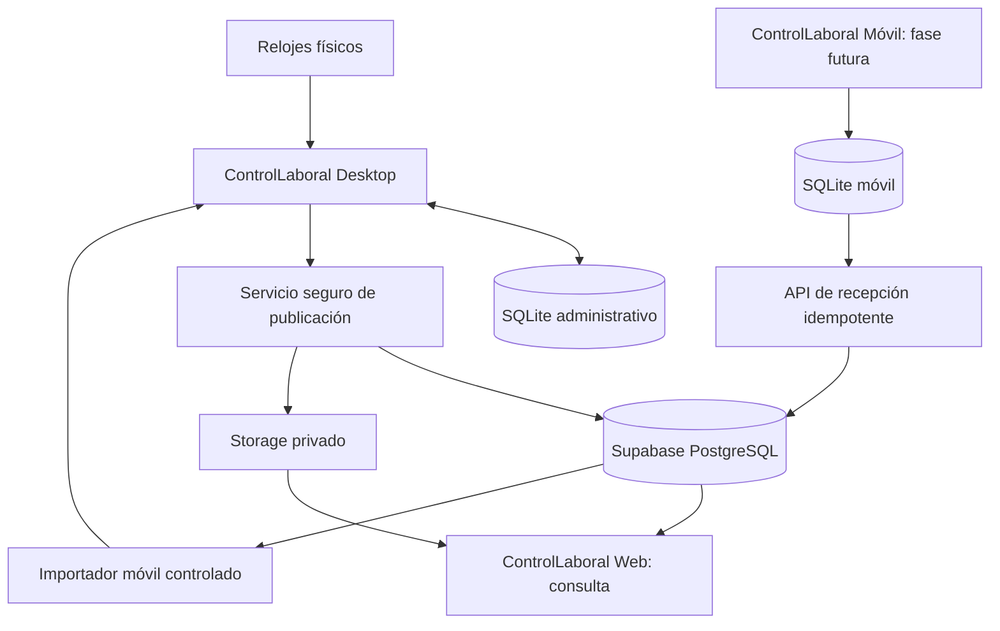

# ControlLaboral — Plan maestro integral de desarrollo v3.0

**Reforma de jornada laboral en México 2026–2030**  
**Versión documental:** 3.0 | **Fecha de referencia:** 24 de noviembre de 2026  
**Destinatarios:** Desarrollo, responsable del sistema y Recursos Humanos  
**Naturaleza:** Especificación funcional, auditoría técnica y criterios de aceptación.

## 0. Mandato de desarrollo: alternativa C aprobada

**Nombre definitivo:** ControlLaboral — Sistema integral de control de asistencia y jornada laboral. Confirmado por el propietario el 24/11/2026.

**Decisión aprobada:** desarrollar una V2 independiente, manteniendo V1 operativa e intacta. V1 es referencia técnica, funcional y operativa permanente, no solo una fuente para la auditoría inicial. Este mandato prevalece sobre cualquier redacción heredada que pudiera sugerir modificar V1. Los capítulos 1–18 consolidan los requisitos anteriores; los capítulos 19–21 establecen el gobierno técnico de V2 el capítulo 22 define SQLite local y los capítulos 23–30 consolidan la arquitectura Desktop, Web y Móvil aprobada.

Antes de cada módulo, historia de usuario, cambio o corrección en V2:

1. Inspeccionar el código equivalente de V1, sus dependencias, configuración, datos y comportamiento observable.
2. Identificar reglas implícitas y casos especiales; registrar rutas, símbolos y evidencia sin inventar hallazgos.
3. Comparar con esta especificación y clasificar como reutilizar, adaptar, refactorizar, reemplazar o desarrollar.
4. Justificar la decisión y registrar la matriz de reutilización. Priorizar código probado compatible con los requisitos actuales, sin heredar errores ni vulnerabilidades.
5. Implementar exclusivamente en V2, con pruebas de caracterización, unitarias e integración según corresponda.
6. Comparar resultados con V1 y con resultados esperados independientes; una coincidencia con V1 no prueba cumplimiento legal.
7. Actualizar documentación, pruebas y control de cambios antes de cerrar el módulo.

No modificar archivos, repositorio, configuraciones, base de datos ni dispositivos de producción de V1. Usar copia de referencia de solo lectura, exportaciones autorizadas y entorno de prueba aislado. No conectar dos importadores a un dispositivo si la lectura consume o borra registros; primero verificar el protocolo y diseñar una fuente de captura segura común o una reproducción de lotes. No eliminar V1 tras liberar V2: conservar acceso histórico según política aprobada.

El agente debe entregar diagnóstico y propuesta de arquitectura antes de implementar. No se autoriza sustituir SQLite como fuente administrativa ni elegir tecnologías restantes sin evaluación, migraciones irreversibles o cambios legales no confirmados por conveniencia. El presente MD es una especificación, no evidencia de código inspeccionado ni pruebas ejecutadas.

## 1. Objetivo y alcance

Construir una V2 independiente, tomando como referencia permanente la aplicación existente que recupera y revisa las checadas del reloj, calcula tiempo trabajado, identifica incidencias y separa horas ordinarias y extraordinarias. Debe funcionar con la reducción gradual de jornada sin cambios anuales de código, preservando resultados históricos y funcionalidades existentes.

Se solicita una V2 independiente (alternativa C), no una reescritura indiscriminada desde cero ni una modificación directa de V1. Quedan fuera del alcance inmediato sustituir el reloj físico (la futura aplicación móvil complementará su función), desarrollar nómina, cálculo monetario, timbrado o gestión integral de personal. Sí se incluye el catálogo CRUD de empleados como fuente maestra que sustituirá al Excel operativo. La clasificación doble/triple se entrega como tiempo, no como importe. Las funcionalidades ya implementadas deberán auditarse, reutilizarse y corregirse únicamente cuando exista una brecha.

No se ha inspeccionado el código ni la base de datos; todos los puntos son requisitos de verificación, no afirmaciones sobre defectos existentes. SQLite local es el motor administrativo elegido; Supabase es el destino de publicación y consulta remota, y posteriormente el receptor de checadas móviles. El lenguaje, framework, proveedor SQLite y arquitectura restante de V2 se validarán tras inspeccionar V1; cualquier cambio deberá justificarse.

### 1.1 Principios obligatorios

- Separar norma legal, horario acordado, política patronal y evidencia de checadas.
- No fijar en código los valores laborales que puedan cambiar. Las restricciones de integridad y el algoritmo sí pertenecen al código.
- Conservar la checada original, incluso si es duplicada, anticipada, tardía o incorrecta.
- Separar tiempo de presencia, tiempo efectivo confirmado, tiempo pendiente y clasificación administrativa.
- No eliminar horas trabajadas por tolerancia, falta de autorización o exceso legal.
- Aplicar la versión de las reglas correspondiente a la fecha trabajada, no a la fecha de consulta.
- No compensar automáticamente horas extras de un día con faltantes de otro.
- Mostrar alertas sin impedir la captura o conservación de evidencia.
- Mantener trazabilidad de cualquier cambio y reproducibilidad de resultados.

## 2. Fundamento normativo y calendario

El decreto publicado el 1 de mayo de 2026 modifica, entre otros, los artículos 58, 59, 61, 66, 68, 69 y 132 de la LFT. Sus transitorios establecen los siguientes parámetros graduales. La reducción no debe disminuir salarios ni prestaciones; el sistema de checadas no deberá presentar la reducción programada como ausencia.

| Año | Ordinaria semanal máxima | Extras art. 66 (dobles) | Extras adicionales art. 68 (triples) | Suma de límites extraordinarios |
|---|---:|---:|---:|---:|
| 2026 | 48 h / 2880 min | 9 h / 540 min | 4 h / 240 min | 13 h |
| 2027 | 46 h / 2760 min | 9 h / 540 min | 4 h / 240 min | 13 h |
| 2028 | 44 h / 2640 min | 10 h / 600 min | 4 h / 240 min | 14 h |
| 2029 | 42 h / 2520 min | 11 h / 660 min | 4 h / 240 min | 15 h |
| 2030 en adelante* | 40 h / 2400 min | 12 h / 720 min | 4 h / 240 min | 16 h |

*Hasta nueva reforma. La suma es un límite de referencia, no autorización para programar esas horas rutinariamente. Las restricciones diarias, de distribución y las especiales también aplican. El trabajo extraordinario responde a circunstancias extraordinarias. El tiempo que rebase los límites no desaparece del registro.*

### 2.1 Reglas complementarias

| Regla | Referencia | Parámetro o tratamiento |
|---|---|---|
| Jornada diurna | 60–61 | 06:00–20:00; máximo diario 480 min |
| Jornada nocturna | 60–61 | 20:00–06:00; máximo diario 420 min |
| Jornada mixta | 60–61 | Máximo diario 450 min; si comprende al menos 210 min nocturnos se clasifica nocturna |
| Descanso en jornada continua | 63–64 | Al menos 30 min; si no puede salir del lugar de trabajo, computar el descanso como tiempo efectivo |
| Distribución de jornada | 58 | Acuerdo entre empleador y trabajador; validar horarios y excepciones con asesoría laboral |
| Tiempo extraordinario | 66 | Hasta 240 min diarios del tramo art. 66, en máximo cuatro días por semana |
| Excedente extraordinario | 68 | Hasta 240 min adicionales por semana; jornada total máxima 720 min diarios |
| Descanso semanal | 69 | Al menos un día por seis trabajados |
| Domingo | 71 | Identificar trabajo dominical para tratamiento correspondiente |
| Descanso y festivos | 73–75 | Identificar trabajo en descanso semanal y obligatorio, sin confundirlo automáticamente con horas extra |
| Emergencias | 65, 67 | Tratamiento separado y revisión jurídica; no aplicar mecánicamente la regla ordinaria |
| Menores de edad | 175–178 | Restricciones especiales; no usar automáticamente reglas de adultos |
| Registro electrónico | 132 XXXIV, 994 IV Bis | Evidencia individual, inicio y fin, exportación a autoridad, acreditación de acuerdo cuando proceda |

**Vigencias:** el decreto entra en vigor el 01/05/2026; no aplicar retrospectivamente sus reglas de distribución extraordinaria a enero–abril de 2026. Para ese periodo revisar el régimen anterior (art. 66: hasta tres horas diarias, tres veces por semana; art. 68 anterior). Cargar una versión histórica separada si se revisan esos registros. Las disposiciones generales del registro electrónico tienen entrada en vigor prevista para el 01/01/2027. No se localizaron lineamientos definitivos de STPS en las fuentes consultadas; verificar antes de liberar.

## 3. Auditoría inicial del sistema existente

El desarrollador deberá inspeccionar todo el repositorio, esquema, procedimientos, vistas, consultas, reportes, tareas programadas, archivos de configuración, pruebas, importadores y exportadores. No realizar reemplazos globales de números sin verificar su significado.

| ID | Revisión | Evidencia requerida |
|---|---|---|
| A01 | Constantes 48, 8, 9, 40, 480, 540, 2880 y equivalentes, multiplicaciones por días, textos fijos | Archivo, función, línea y propósito |
| A02 | Cálculo diario/semanal y orden de clasificación | Diagrama del flujo actual, ejemplos reproducibles |
| A03 | Horarios, asignaciones, días de descanso y vigencias | Esquema y pantallas existentes |
| A04 | Tolerancias y redondeos | Reglas actuales, límites, efectos sobre tiempo real |
| A05 | Importación y emparejamiento de checadas | Formatos, claves, duplicados, reloj y zona horaria |
| A06 | Alertas y validaciones legales | Umbrales, destinatarios, momento de detección |
| A07 | Correcciones y autorizaciones | Bitácora y permisos |
| A08 | Reportes, exportación e integraciones | Columnas, unidades, dependencias |
| A09 | Resultados históricos y cierres | Capacidad de reproducir cálculo anterior |
| A10 | Seguridad, rendimiento y recuperación | Pruebas, respaldos y control de acceso |

Registrar por cada hallazgo: ID, componente, comportamiento actual, requisito esperado, estado (cumple/parcial/no cumple/no aplica/pendiente), riesgo, propuesta de cambio, prueba asociada y responsable. No marcar como cumplido sin evidencia. Antes de cambiar código, crear respaldo y pruebas de caracterización del comportamiento actual.

## 4. Configuración funcional requerida

### 4.1 Normatividad laboral (NL)

Catálogo versionado de reglas legales. Campos sugeridos (adaptar a tablas existentes): identificador, jurisdicción, régimen, inicio/fin de vigencia, minutos ordinarios semanales, máximos diarios por tipo, franja nocturna, umbral de jornada nocturna, límites art. 66 diario/semanal/días, límite adicional art. 68, máximo diario total, regla de descanso, fuente oficial, estado y usuario autorizador.

- NL01: cargar calendario anterior y futuro conforme a sección 2.
- NL02: seleccionar automáticamente por fecha efectiva; prohibir solapamientos o huecos sin tratamiento explícito.
- NL03: los parámetros legales no deben ser libremente editables por usuarios operativos. Una modificación exige perfil autorizado, fundamento y nueva versión.
- NL04: si falta una versión aplicable, bloquear únicamente el cálculo definitivo; conservar registros y mostrar incidencia.
- NL05: los límites legales deben ser independientes de límites patronales más restrictivos.
- NL06: no confundir el límite art. 66 con el límite total art. 68; ambos generan alertas distintas.

### 4.2 Horarios y asignaciones (HO)

El límite ordinario de cada trabajador depende de su horario vigente acordado, no del máximo legal general. Reutilizar el catálogo existente si cumple.

Campos: horario, trabajador/grupo asignado, centro, zona horaria, días, intervalos ordinarios, descansos, carácter computable de cada descanso, tipo de jornada, inicio/fin de vigencia, régimen, referencia del acuerdo.

- HO01: permitir diferentes horarios cada día, jornadas parciales, turnos partidos y nocturnos.
- HO02: calcular automáticamente minutos ordinarios diarios y semanales a partir de intervalos, descontando únicamente descansos no computables.
- HO03: validar programación contra topes aplicables. Un horario incompatible requiere corrección o revisión jurídica documentada; no normalizar como ordinarias las horas que excedan el límite sin fundamento.
- HO04: asignaciones históricas sin traslapes ambiguos; una excepción temporal documentada no modifica el horario base.
- HO05: diferenciar descanso semanal, día no programado, festivo y ausencia.
- HO06: identificar horario faltante; no inventar 8 h ni 48 h por defecto.
- HO07: prever horarios del siguiente año y reporte de trabajadores cuyo horario excederá el nuevo máximo; no imponer unilateralmente una distribución.

Ejemplo diurno ilustrativo (horas efectivas). No es una regla: la distribución de cada año la define el horario acordado vigente.

| Año | Lunes a viernes por día | Sábado | Total |
|---|---:|---:|---:|
| 2026 | 8 | 8 | 48 |
| 2027 | 8 | 6 | 46 |
| 2028 | 8 | 4 | 44 |
| 2029 | 8 | 2 | 42 |
| 2030 | 8 | 0 | 40 |

Otras distribuciones posibles: en 2027, seis días de 7 h 40 min; en 2028, lunes a viernes de 7 h 36 min (7.6 h = 456 min) y sábado de 6 h (= 44 h). No asumir que la reducción siempre ocurre el sábado ni que la jornada de lunes a viernes se mantiene en 8 h; cada año puede cambiar la distribución completa. El sistema guarda y calcula en minutos, nunca en horas decimales redondeadas.

### 4.3 Tolerancias (TO)

Decisión aceptada: el patrón configura tolerancias de 0 a 15 minutos inclusive, conforme al reglamento aplicable. El máximo de 15 es una decisión funcional, no un derecho general establecido en la LFT.

| Campo | Rango | Finalidad |
|---|---|---|
| Entrada anticipada | 0–15 min | Marcar diferencia administrativa anterior al inicio |
| Entrada tardía | 0–15 min | Clasificar puntualidad o retardo |
| Salida anticipada | 0–15 min | Clasificar salida antes del horario |
| Salida posterior | 0–15 min | Marcar diferencia administrativa posterior al cierre |
| Regreso de comida | 0–15 min | Clasificar regreso tardío, si existe esta checada |

- TO01: valores enteros; rechazar negativos, decimales y mayores de 15.
- TO02: configuración por empresa y, si el sistema lo permite, por centro/horario; prioridad explícita y vigencia. No asumir que todos tienen igual tolerancia.
- TO03: el límite exacto se considera dentro de tolerancia (ej. 07:10 con 10 min); 07:10:01 queda fuera si se registran segundos. Mostrar precisión usada.
- TO04: tolerancia cero significa sin margen. No altera el tiempo físico.
- TO05: registrar diferencia real y diferencia administrativa por separado. Si se configura retardo desde inicio o solo excedente, ambas magnitudes se conservan.
- TO06: no aplicar tolerancia para suprimir trabajo efectivo, sustituir checadas o aumentar artificialmente horas normales. Una permanencia fuera de horario sin evidencia de trabajo se marca pendiente o no laborada según revisión justificada.
- TO07: conservar reglamento/versiones y motivo de excepciones autorizadas.

Ejemplo: entrada 07:00, tolerancia 10; checada 07:12: diferencia real 12 min; incidencia administrativa 12 o 2 según política; nunca modificar el evento 07:12. Salida 16:10 con tolerancia 10: si trabajó hasta esa hora, reconocer los 10 minutos; si solo esperó para checar, documentar la revisión.

### 4.4 Alertas (AL)

Configurar anticipación preventiva (minutos o porcentaje), límite interno opcional y destinatarios. Los umbrales de infracción legal se derivan de NL, no de la libre elección patronal.

| Código | Disparador | Nivel |
|---|---|---|
| AL01 | Próximo a límite ordinario diario/semanal | Preventivo |
| AL02 | Tiempo extraordinario detectado | Informativo/revisión |
| AL03 | Próximo a tope art. 66 semanal | Preventivo |
| AL04 | Tope art. 66 alcanzado / superado | Advertencia diferenciada |
| AL05 | Distribución art. 66 superior a 4 h/día o 4 días/semana | Crítico/revisión legal |
| AL06 | Tramo adicional art. 68 próximo a / superior a 4 h semanales | Preventivo/crítico |
| AL07 | Tiempo total diario próximo a / superior a 12 h | Preventivo/crítico |
| AL08 | Descanso semanal no acreditado | Crítico/revisión |
| AL09 | Horario futuro incompatible con reforma | Preventivo |
| AL10 | Checada incompleta, duplicada o inconsistente | Revisión |
| AL11 | Exceso de umbral interno patronal | Advertencia administrativa |
| AL12 | Horario/norma ausente o transición no resuelta | Cálculo pendiente |

En 2027, con anticipación de 60 min: avisar a las 8 h extraordinarias, marcar límite alcanzado a 9 h, señalar excedente del umbral al rebasar 9 h; a 13 h se alcanza el límite combinado y al superarlo se genera alerta crítica. No esperar a 13 h si ya existe infracción de distribución diaria. La clasificación jurídica de extras que violan límites de distribución sin exceder el umbral semanal deberá validarse; no asumir que siempre son dobles.

Si el sistema importa checadas por lotes, las alertas se emiten al revisar/importar. No prometer alertas en tiempo real sin conexión continua al reloj. Proyección con turno abierto solo cuando exista información suficiente, marcada como estimación. Deduplicar alertas por trabajador, periodo, regla y versión; permitir reconocerlas, no borrarlas ni ocultar incumplimientos.

### 4.5 Otras reglas (RE)

- RE01: día/hora de inicio de semana laboral definido y documentado; no confundir con corte de nómina. No reiniciar acumulados en mitad de semana por cambio de mes, año o periodo de pago.
- RE02: calendario de festivos legales versionado y descansos específicos por trabajador. Hoy no existe ningún calendario (V1 no lo tiene); en V2 es **obligatorio capturar uno por cada año** (decisión del propietario, 26/11/2026).
  - Sin calendario confirmado para el año, el cálculo de sus semanas es provisional: se puede consultar, pero no cerrar, autorizar ni exportar a nómina. Desde el 1 de diciembre se alerta si falta el calendario del año siguiente.
  - Al crear un año, V2 precarga como sugerencia los descansos obligatorios del art. 74 LFT (incluidos los móviles: lunes por regla, 1 de octubre en transmisión del Ejecutivo Federal, jornadas electorales). RH revisa, agrega los días propios de la empresa y confirma; hasta entonces el calendario no es válido. La lista del art. 74 debe verificarse contra el texto vigente de la LFT antes de implementarla (no está transcrita en `Documentacion/00`).
- RE03: autorización de extras como atributo independiente; no excluye tiempo efectivamente trabajado.
- RE04: reglas de compensación o redistribución solo con base válida, acuerdo y trazabilidad; desactivadas por defecto.
- RE05: detección de duplicados, checadas faltantes y correcciones manuales sin destrucción de originales.
- RE06: permisos, vacaciones, incapacidades y otras incidencias no son horas efectivamente trabajadas; conservarlas separadas.
- RE07: precisión y redondeo: calcular con segundos enteros (o minutos enteros si la fuente no tiene segundos); no redondear cada intervalo en perjuicio del trabajador; presentar HH:mm:ss o HH:mm según precisión.

## 5. Motor de revisión de checadas

### 5.1 Entrada y normalización

1. Importar evento con identificador de trabajador/dispositivo, fecha y hora originales, zona horaria, tipo de movimiento si existe, identificador de origen y lote.
2. Garantizar idempotencia de importación; si el dispositivo no ofrece ID, usar clave compuesta documentada y revisión de colisiones. Conservar evidencia de duplicados reales.
3. Ordenar cronológicamente por instante, no por orden de importación. Identificar desfases de reloj, eventos futuros y cambios de fecha.
4. Emparejar entradas y salidas según la semántica del dispositivo. No asumir alternancia perfecta. Marcar registros ambiguos y pedir revisión; no fabricar una salida definitiva. El emparejamiento se hace sobre la secuencia unificada del trabajador con las checadas de **todos** los relojes, no por reloj: una jornada puede empezar en el reloj de una empresa y terminar en el de otra (p. ej. entrada en CATAB y salida en AEI; decisión del propietario, 26/11/2026). Cada checada conserva su reloj y empresa de origen. Si dos intervalos de relojes distintos se traslapan, alertar y no contar dos veces el mismo minuto. **Traslado entre empresas:** cuando una salida en el reloj de una empresa va seguida, el mismo día, de una entrada en el reloj de otra, el hueco cuenta como tiempo efectivo con la etiqueta «traslado entre empresas»; si supera el máximo configurable (parámetro versionado, valor inicial 60 min), queda pendiente de revisión y no se computa automáticamente (decisión del propietario, 26/11/2026; interpretación del art. 58 LFT —tiempo a disposición del patrón—, primer párrafo no transcrito en `Documentacion/00`; requiere validación del asesor laboral).
5. Asociar jornada lógica y día de inicio a turnos nocturnos, separando segmentos por fecha real cuando sea necesario para vigencias y festivos. Evitar doble contabilización.
6. Obtener horario, norma y tolerancias vigentes. Si faltan, informar y dejar resultado provisional.

### 5.2 Determinar exactamente dónde empiezan las horas extraordinarias

Clasificar intervalos efectivos confirmados, no solo la diferencia entre la primera y última checada. Excluir descansos no computables acreditados; incorporar descansos computables aunque no exista trabajo activo.

Para cada intervalo, dividir en fronteras relevantes: inicio/fin de horario, descansos, medianoche, fin de semana, cambio de vigencia y agotamiento de topes. Cada segmento conserva inicio, fin, duración, categoría base, etiquetas adicionales y regla aplicada.

**Criterio de inicio de extra (decisión del propietario, 24/11/2026; parámetro normativo versionado, sujeto al reglamento STPS y al dictamen del asesor laboral):** criterio «semanal con acuerdo» por defecto desde 2027.

1. **Cuánto:** extra semanal = máx(0, tiempo efectivo confirmado de la semana − tope ordinario semanal vigente, p. ej. 46 h en 2027). Los días cortos se compensan con los largos dentro de la misma semana.
2. **Dónde:** las horas extra se asignan solo a segmentos de exceso diario (trabajo confirmado fuera del horario acordado del día, incluido el trabajo en días sin horario). Si el exceso total supera la extra semanal (porque hubo faltantes), los excesos más antiguos compensan los faltantes y la extra se asigna a los excesos más recientes. Si la extra semanal supera la suma de excesos diarios (solo ocurre cuando el horario acordado de la semana rebasa el tope vigente), el remanente se asigna a los últimos minutos programados de la semana, en orden cronológico inverso, y se emite la alerta HO03 «horario incompatible con el tope legal». El tiempo nunca se pierde ni se bloquea el cálculo; RH debe corregir el horario (decisión del propietario, 26/11/2026).
3. **Límites:** con esa asignación se evalúan los límites del art. 66 (4 h/día, 4 días/semana), el tope diario de 12 h del art. 68 y los tramos doble/triple. Nunca se cargan al último día todas las extras de la semana.
4. El criterio se guarda en cada semana calculada. Si el reglamento STPS o el dictamen lo cambian, se crea una nueva versión del parámetro, sin cambiar código.

El trabajo efectivo confirmado antes del inicio o después del fin acordado es exceso diario y es candidato a extra según el criterio anterior; no desplazar automáticamente el horario por una entrada tardía. Las redistribuciones válidas se evalúan como excepción explícita. Los descansos semanales/festivos y regímenes especiales requieren clasificación propia y revisión de posibles concurrencias.

Ejemplo horario 07:00–12:00 y 13:00–16:00; checadas 06:50, 12:00, 13:00, 16:25. Si todo el tiempo fuera de horario fue efectivamente trabajado: 8 h normales y 35 min extras. Si los 10 min previos fueron solo presencia, 25 min extras; si no se sabe, conservar esos 10 min como pendientes.

Ejemplo 2027: trabajador con 40 h normales acumuladas de lunes a viernes; sábado programado 07:00–13:00 continuo (descanso computable según corresponda). Si trabaja hasta 15:00, acumula 6 h ordinarias y 2 h extraordinarias. Si existe descanso no computable, ajustar frontera con intervalos efectivos y horario acordado.

Ejemplo 2027, horario 5 × 8 + 6: trabaja 9 h de lunes a sábado (54 h). Extra semanal = 54 − 46 = 8 h. Excesos diarios: 1 h lunes a viernes + 3 h sábado = 8 h. Resultado: 1 h extra por día de lunes a viernes y 3 h el sábado. Ningún día rebasa 4 h; extras en 6 días → alerta del límite de 4 días del art. 66, sin borrar tiempo.

Ejemplo de compensación, horario 5 × 8 + 6: lunes 10 h, martes 10 h, miércoles 4 h, jueves 8 h, viernes 8 h, sábado 6 h (46 h). Extra semanal = 0; los excesos de lunes y martes (4 h) compensan el faltante del miércoles (4 h). Si el miércoles fueran 6 h (48 h): extra = 2 h; el exceso más antiguo (lunes) compensa el faltante de 2 h y la extra se asigna al exceso más reciente (martes, 2 h).

Ejemplo de horario incompatible, 2027: horario acordado 6 × 8 h (48 h) trabajado exactamente. Extra semanal = 48 − 46 = 2 h; no hay excesos diarios, así que las 2 h se asignan a los últimos 120 min programados del sábado y se emite HO03.

### 5.3 Acumulación semanal y clasificación de extras

- Acumular ordinarias y extraordinarias por trabajador, patrón y semana laboral, sumando las checadas de todos los relojes y centros de trabajo de esa semana contra un solo tope (decisión del propietario, 26/11/2026). La extra se reporta a nombre del patrón; cada segmento conserva la empresa y el reloj donde se generó. Si existe más de un contrato/régimen o más de un patrón simultáneo, definir alcance con RH.
- Marcar primero cada segmento como dentro de horario o exceso diario; calcular la extra semanal según el criterio vigente (§5.2) y asignarla a los segmentos de exceso. El exceso no asignado como extra es ordinario. Nunca contar el mismo minuto dos veces como ordinario y extra.
- En casos regulares, asignar cronológicamente el tramo doble hasta el máximo semanal art. 66 y el excedente al tramo triple. Si un segmento cruza umbral, dividirlo exactamente.
- Evaluar por separado límite diario y número de días de extras art. 66. Si se rebasan antes del umbral semanal, marcar revisión jurídica de clasificación; no ocultar ni declarar automáticamente legal el tramo por ser menor a 9 h.
- Más allá del tramo adicional de 4 h, mantener el tiempo extraordinario y etiqueta de exceso legal. No inventar una cuarta categoría de pago ni limitar el cómputo a 13/14/15/16 h.
- Recalcular desde inicio de semana al corregir una checada anterior, pues puede cambiar el instante de cruce doble/triple.
- Mantener faltantes separados; la suma semanal no anula automáticamente extras diarias.

Pseudocódigo orientativo (no sustituye implementación actual):

```text
para cada trabajador y semana:
    eventos = cargar_originales_y_ajustes_autorizados()
    intervalos, incidencias = reconstruir_intervalos(eventos)
    segmentos = dividir_por_horarios_descansos_y_vigencias(intervalos)
    para segmento en orden cronologico:
        regla = obtener_norma(segmento.fecha)
        horario = obtener_horario(segmento.fecha, trabajador)
        si datos insuficientes: marcar_pendiente(segmento); continuar
        si descanso_no_computable: clasificar_no_laborado(); continuar
        si trabajo_no_confirmado: marcar_pendiente(); continuar
        clasificar_categoria_base_por_horario_y_regimen()
        marcar_dentro_de_horario_o_exceso_diario()
        acumular_tiempo_confirmado()
    extra = max(0, confirmado_semana - tope_semanal_vigente)
    asignar_extra_a_excesos_mas_recientes(extra)
    para segmento en orden cronologico:
        asignar_tramos_extra_y_marcar_excepciones_de_distribucion()
        evaluar_alertas_diarias_semanales_y_de_descanso()
    validar_conciliacion_de_totales()
    guardar_resultado_versionado_y_evidencias()
```

### 5.4 Invariantes de cálculo

- Presencia reconstruida = tiempo efectivo confirmado + descansos/no laborado + tiempo pendiente, cuando los intervalos sean completos y no superpuestos.
- Tiempo efectivo confirmado = ordinario + extraordinario + trabajo especial clasificado como categoría base independiente. Etiquetas domingo, festivo, alerta, autorización y exceso legal no se suman nuevamente.
- Extra ordinaria del régimen general = doble + triple + extra pendiente de clasificación jurídica (categorías excluyentes; exceso legal es etiqueta adicional).
- Ningún total negativo. Ningún minuto duplicado. El orden de recepción no altera resultado. Mismos datos y versiones producen mismo resultado.
- Si falta una checada, no declarar como cero el tiempo desconocido. Mostrar pendientes explícitos.

## 6. Datos, historial y seguridad

Adaptar las siguientes entidades lógicas a la estructura existente; no crear tablas redundantes si ya cumplen.

| Entidad | Datos esenciales |
|---|---|
| Norma versionada | Vigencia, límites, fuente, versión |
| Horario e intervalos | Días, inicios/fines, descansos, tipo, vigencia |
| Asignación | Trabajador, horario, vigencia, acuerdo |
| Política | Tolerancias, alertas, semana, ámbito, versión |
| Checada original | ID, origen, instante, zona, movimiento, lote |
| Ajuste/incidencia | Original relacionado, motivo, evidencia, antes/después, autor, fecha |
| Segmento revisado | Inicio/fin, duración, categoría, etiquetas, versión |
| Resultado diario/semanal | Totales, pendientes, versión de reglas y algoritmo, estado |
| Alerta | Regla, instante de detección, exceso, reconocimiento, estado |
| Auditoría | Actor, acción, objeto, valores antes/después, fecha |

- Usar claves e índices por trabajador/fecha y restricciones de integridad de vigencias. Procesar transaccionalmente; evitar revisiones concurrentes inconsistentes.
- Conservar fecha local e instante inequívoco, considerando zonas mexicanas y cambios históricos de horario.
- Control de acceso según perfiles existentes: consulta, revisión, autorización y configuración legal. Registrar modificaciones y exportaciones relevantes.
- No replicar plantillas biométricas si basta con el identificador del reloj. Proteger datos personales y respaldos; definir retención conforme a obligaciones aplicables, sin inventar un plazo único.
- Cierres: una corrección posterior genera nueva revisión, no sobrescribe silenciosamente el resultado aprobado. Mostrar original, diferencia y versión recalculada.

## 7. Pantallas y reportes a revisar

### 7.1 Configuración

Mantener estilo de interfaz actual. Incorporar o adaptar secciones de normatividad, horarios/asignaciones, tolerancias, alertas y reglas de procesamiento. Mostrar vigencia, referencia legal y vista previa de impacto. Validar rangos antes de guardar. Mostrar cambios futuros sin afectar revisión actual.

### 7.2 Revisión diaria

Mostrar horario programado, checadas reales, intervalos efectivos, descansos, tiempo normal, extra, tiempo pendiente, retardo/salida anticipada, tipo de jornada, alertas, autorización y motivo de ajuste. Permitir ver el instante exacto de inicio/fin de cada segmento extraordinario.

Ejemplo: 16:00–16:25, extra confirmada; 06:50–07:00, pendiente de confirmar; 12:00–13:00, descanso no computable. No mostrar únicamente un total sin trazabilidad.

### 7.3 Revisión semanal

Columnas: día, horario previsto, horas programadas, checadas, normales, dobles, triples, extras pendientes de clasificación, descanso/festivo trabajado, faltante, pendiente, acumulados y alertas. Resumen de límites legales y contractuales, versión y fecha de revisión. Mostrar HH:mm, no confundir 7.40 decimal con 7 h 40 min.

### 7.4 Reportes y exportaciones

Revisar los existentes y ampliar solo si es necesario: revisión diaria/semanal, excepciones, exceso de jornada, límites próximos, horarios incompatibles, checadas originales y ajustes, evidencia individual de inicio/fin de jornada, diferencias de recalculación y exportación de totales para sistemas externos. Conservar contratos de integración; si cambian columnas o unidades, versionar exportación. No incluir cálculo de nómina.

## 8. Transiciones y casos que requieren decisión

- Semana que cruza 01/01/2027 (por ejemplo 28/12/2026–03/01/2027 si la semana inicia lunes): aplicar horarios/normas por fecha, conservar semana completa y no reiniciar acumulados artificialmente. La regla exacta de tope semanal transitorio requiere validación jurídica; no imponer prorrateo ni aplicar 46/48 a toda la semana sin fundamento. Si no hay criterio aprobado, resultado provisional con alerta y evidencia intacta.
- Turno que cruza medianoche o una vigencia: preservar jornada lógica para límites diarios y segmentar fechas para condiciones legales; no duplicar minutos.
- Cambio de horario a mitad de semana: aplicar asignación vigente y validar el total; no reemplazar histórico.
- Horarios flexibles, redistribuciones acordadas, guardias, emergencias, menores y regímenes especiales: definir reglas y pruebas específicas si existen; no habilitar excepciones genéricas sin aprobación.
- Descanso semanal/festivo trabajado: identificar concurrencias con tiempo extraordinario; criterio de clasificación validado por RH/jurídico.
- Tolerancia administrativa: patrón define valores y método de incidencia; confirmar si el reloj distingue inicio/fin de comida.
- Confirmar qué constituye evidencia de trabajo efectivo fuera de horario y quién puede resolver pendientes.

## 9. Matriz mínima de pruebas de aceptación

Salvo indicación, jornada diurna regular, sin festivo, tiempo efectivo confirmado, semana completa, horario acordado y descansos ya descontados. Las pruebas no deben depender del reloj real ni de la fecha actual del equipo.

| ID | Escenario | Resultado esperado |
|---|---|---|
| P01 | 2026, 48 h ordinarias acordadas | 48 normales, sin extra |
| P02 | 2027, horario 46 h, trabajo 48 h con 2 h fuera de horario | 46 normales, 2 dobles |
| P03 | 2028, horario 44 h, trabajo 48 h con 4 extras en distribución válida | 44 normales, 4 dobles |
| P04 | 2029, horario 42 h, 6 extras en distribución válida | 42 normales, 6 dobles |
| P05 | 2030, horario 40 h, 8 extras en distribución válida | 40 normales, 8 dobles |
| P06 | Contrato 40 h en 2027, 2 h fuera de horario | 40 normales, 2 extras |
| P07 | Lunes 10 h para 8; martes 6 h para 8; resto completo hasta 46 efectivas | 44 normales, 2 extras, 2 faltantes |
| P08 | 2027, 9 h extras distribuidas válidamente | 9 dobles, aviso tope alcanzado |
| P09 | 2027, 9 h 1 min extras en distribución válida | 9 dobles, 1 min triple; aviso excedente art. 66 |
| P10 | 2027, 13 h extras | Alcanzado límite agregado; evaluar además distribución |
| P11 | 2027, 13 h 1 min extras | Alerta crítica, preservar minuto excedente |
| P12 | 2028, 10 h y luego 1 min extra | Cruce doble/triple en 10 h |
| P13 | 2029, 11 h y luego 1 min extra | Cruce en 11 h |
| P14 | 2030, 12 h y luego 1 min extra | Cruce en 12 h |
| P15 | Extras art. 66 superiores a 4 h en un día, total diario >12 h | Alertas independientes, tiempo íntegro |
| P16 | Extras art. 66 en cinco días, total semanal 5 h | Alerta de distribución aunque no supere 9 h; revisión jurídica |
| P17 | Jornada total 12 h exactas / 12 h 1 min | Límite alcanzado / superado |
| P18 | Entrada 07:10 con tolerancia 10 | Dentro de tolerancia; diferencia real 10 |
| P19 | Entrada 07:11 con tolerancia 10 | Fuera de tolerancia; conservar 11 min |
| P20 | Tolerancia 0, 15, -1, 16 y 1.5 | Aceptar 0 y 15; rechazar los demás |
| P21 | Salida 16:10 con 10 min de tolerancia y trabajo acreditado | 10 min extra, no eliminados |
| P22 | Salida 16:10 sin certeza de trabajo | 10 min pendientes, original intacto |
| P23 | Entrada anticipada efectiva 10 min | Extra según horario, aunque esté dentro de tolerancia |
| P24 | Comida no computable acreditada 60 min | Excluir 60 min |
| P25 | Comida computable 30 min | Incluir 30 min |
| P26 | Turno 22:00–05:00 | 7 h nocturnas, sin duplicación por fecha |
| P27 | Mixta con 3 h 29 min nocturnos / 3 h 30 min | Mixta / nocturna |
| P28 | 7 días seguidos trabajados sin descanso acreditado | Alerta de descanso |
| P29 | Trabajo domingo o festivo | Etiquetas correctas; no asumir extras automáticamente |
| P30 | Falta de salida | Incidencia pendiente, sin hora ficticia definitiva |
| P31 | Importar lote idéntico dos veces | Mismo total, sin duplicar trabajo |
| P32 | Eventos llegan desordenados | Mismo resultado tras ordenar |
| P33 | Trabajador sin horario o norma | Cálculo pendiente, datos conservados |
| P34 | Semana cruza año | Semana íntegra, vigencias por fecha, política aprobada o pendiente |
| P35 | Corrección de lunes cambia acumulado de viernes | Recalcular semana y cruce doble/triple |
| P36 | Consulta 2026 después de activar 2027 | Resultado histórico con norma 2026 aplicable |
| P37 | Usuario operativo intenta modificar límite legal | Denegado y auditado |
| P38 | Extra no autorizada pero efectivamente trabajada | Conservar tiempo y etiqueta de autorización |
| P39 | Jornada 7 h 40 min durante 6 días | 46 h exactas; sin error decimal |
| P40 | Jornada 2026 enero–abril | Norma histórica anterior; no aplicar límites de distribución nuevos |
| P41 | Horario 48 h con vigencia 2027 | Advertir incompatibilidad, no aprobar silenciosamente |
| P42 | Ajuste de revisión ya cerrada | Nueva versión, original y cierre previo conservados |
| P43 | Restaurar respaldo y reprocesar | Resultados reproducibles con mismas versiones |
| P44 | Exportar revisión con pendientes y alertas | Totales conciliados, pendientes visibles, unidades explícitas |
| P45 | Dos relojes para mismo trabajador | Consolidación sin duplicar intervalos |
| P46 | Semana de nómina partida por cierre de mes | Acumulación laboral sin reinicio indebido |
| P47 | 2027, umbral preventivo de 8 h, acumulado 7:59/8:00 | Sin aviso / aviso preventivo |
| P48 | Reimportar datos con misma alerta | No generar múltiples avisos idénticos |
| P49 | Horario futuro ya configurado | No afecta cálculo actual; sí simulación futura |
| P50 | Reglamento cambia tolerancia a mitad de mes | Cada checada utiliza versión correspondiente |

Agregar pruebas de regresión específicas según hallazgos A01–A10. Probar volumen realista y medir duración de importación, cálculo y exportación contra línea base; fijar metas con responsable técnico, no inventar SLA.

## 10. Plan de ejecución y migración

### Fase 1 — Diagnóstico
- [ ] Inventariar repositorio y componentes actuales; respaldar base y configuraciones.
- [ ] Elaborar matriz de brechas A01–A10 con evidencias.
- [ ] Capturar resultados de referencia de semanas reales anonimizadas y casos límite.
- [ ] Confirmar políticas actuales con RH y criterios legales pendientes.

### Fase 2 — Parametrización
- [ ] Reutilizar/ampliar catálogos existentes y crear migraciones incrementales.
- [ ] Cargar vigencias legales y asignaciones históricas sin alterar originales.
- [ ] Configurar horarios 2027 y detectar incompatibilidades antes de activación.
- [ ] Validar tolerancias, alertas y permisos.

### Fase 3 — Motor y presentación
- [ ] Eliminar dependencia de constantes laborales en cálculos, filtros y textos.
- [ ] Implementar segmentación, clasificación, acumulación, alertas y excepciones.
- [ ] Adaptar pantallas, reportes y exportaciones; mantener compatibilidad.
- [ ] Implementar o verificar registro electrónico, auditoría y revisión de pendientes.

### Fase 4 — Pruebas y liberación
- [ ] Ejecutar matriz de aceptación y regresión.
- [ ] Comparar sistema anterior y nuevo sobre copia de datos; documentar toda diferencia.
- [ ] Revisar normas y disposiciones STPS vigentes al momento de liberar.
- [ ] Obtener aprobación de RH, responsable técnico y asesor laboral para criterios pendientes.
- [ ] Ensayar migración y restauración; desplegar antes de 01/01/2027.
- [ ] Verificar primer ciclo semanal de 2027 y transición; atender discrepancias sin borrar historial.

**Migración:** preferir cambios aditivos, versionar esquema, probar en entorno separado, hacer respaldo verificable, conservar IDs originales y establecer rollback. No recalcular masivamente cierres históricos sin autorización. Si se retrocede de versión, preservar registros ingresados durante el despliegue; no restaurar ciegamente una copia que los pierda.

## 11. Entregables y definición de terminado

1. Informe de auditoría con ubicación exacta de cada hallazgo y estado.
2. Especificación de cambios aprobada y decisiones pendientes resueltas o bloqueos explícitos.
3. Migraciones, configuración inicial y documentación de vigencias.
4. Código de V2 y pruebas automatizadas de cálculo; evidencia de pruebas de interfaz e integración.
5. Comparativa de resultados anteriores/nuevos y justificación de diferencias.
6. Manual breve de configuración y revisión, procedimiento de respaldo/rollback y notas de versión.
7. Matriz de aceptación completa con resultado, evidencia, responsable y fecha.

**Criterio final:** el sistema puede procesar 2026–2030 y años posteriores conforme a reglas versionadas, sin cambiar el código cada enero; detecta el inicio exacto del trabajo extraordinario en casos regulares, mantiene pendientes donde falte evidencia, aplica tolerancias de 0–15 min sin borrar trabajo, avisa al alcanzar y superar límites, conserva originales e histórico y supera pruebas de regresión. Ninguna brecha crítica ni criterio jurídico relevante queda oculto. La conformidad definitiva se valida con el sistema real y las disposiciones aplicables.

## 12. Fuentes y control de actualización

- DOF, decreto de reforma a la LFT, 01/05/2026: https://dof.gob.mx/nota_detalle_popup.php?codigo=5786537
- SIDOF, mismo decreto: https://sidof.segob.gob.mx/notas/docFuente/5786537
- LFT vigente, Cámara de Diputados: https://www.diputados.gob.mx/LeyesBiblio/pdf/LFT.pdf (consultar versión al implementar).
- DOF, consulta de publicaciones y disposiciones STPS: https://www.dof.gob.mx/
- Referencia secundaria de seguimiento, estado reportado al 23/11/2026: https://audantra.com/lineamientos-registro-electronico-de-jornada/ . No sustituye publicación oficial.

La versión documental anterior reportó haber contrastado la tabla y los límites con el decreto del 1 de mayo de 2026; esta consolidación no constituye una nueva verificación jurídica. No se verificó el código actual ni se ha confirmado una regla oficial específica para semanas entre vigencias; tampoco se localizaron disposiciones definitivas de registro electrónico en las fuentes consultadas. Actualizar el documento y las reglas correspondientes cuando exista publicación oficial o criterio jurídico aprobado.


## 13. Catálogo de empleados y sustitución de Excel (ampliación v1.1)

### 13.1 Alcance y requisitos

Actualmente el catálogo se administra en Excel. Migrarlo a la base de datos independiente de V2, con CRUD completo y baja lógica. Excel será únicamente origen de migración inicial y formato opcional de exportación; no debe continuar como dependencia operativa. Auditar antes de elegir tablas y tecnologías; no duplicar catálogos existentes.

| Operación | Criterio de aceptación |
|---|---|
| Alta | Identificador interno estable, validación de campos y duplicados, asignación de horario y vínculo al reloj |
| Consulta | Búsqueda por número, nombre, identificador del reloj, estado y filtros disponibles |
| Edición | Validación, permisos, bitácora y vigencias de cambios laborales |
| Baja | Desactivar sin borrar checadas, revisiones, relaciones ni exportaciones históricas |
| Reactivación | Registrar nueva vigencia y conservar la baja previa; no reutilizar identidad de otra persona |

Campos propuestos: ID interno, número de empleado, nombre y apellidos, patrón (empresa con la que el trabajador está dado de alta ante el IMSS) y centro de trabajo/empresa donde labora y checa, cada uno con vigencia, departamento y puesto si existen, fecha de ingreso y baja, estado, horario y política de tolerancias asignados por vigencia. CURP/RFC únicamente cuando sean necesarios y autorizados; no exigir datos bancarios, médicos o biométricos. Conservar identificación histórica en reportes. Definir permisos de consulta, alta, edición, baja, reactivación e importación; registrar usuario, fecha y valores anteriores/nuevos.

Separar el empleado de su identificador externo en el reloj mediante una relación con dispositivo/origen y vigencias. No asumir que el ID del reloj es globalmente único o permanente. Impedir solapamientos ambiguos; si un código se reutiliza, resolverlo conforme a la fecha de la checada. Los registros sin correspondencia quedan pendientes, nunca se asignan por aproximación de nombre. No borrar empleados con dependencias.

El patrón y el centro de trabajo son datos distintos: un trabajador puede checar en el reloj de una empresa y estar dado de alta ante el IMSS con otra (decisión del propietario, 26/11/2026; en V1 corresponde al campo informativo `empresa_base`, cuyo valor inicial común es AEI, la primera empresa del sistema). Los reportes y exportaciones de tiempo extra identifican al patrón responsable; el centro de trabajo indica dónde se generó la checada. Un trabajador puede checar en relojes de varias empresas en la misma semana o en la misma jornada: V2 mantiene **un solo registro de empleado** para todas las empresas (a diferencia de V1, que tiene un catálogo por empresa) con un código por reloj y vigencia.

### 13.2 Migración

1. Inventariar columnas, formatos, claves, duplicados y vínculos utilizados por el Excel actual. Respaldar archivo y base de datos.
2. Preparar importador con mapeo explícito, vista previa, validación de ceros iniciales, fechas, nombres, IDs duplicados, horarios y referencias faltantes. No inventar datos ni corregir identidades automáticamente.
3. Ejecutar simulación en copia; conciliar número de empleados, activos/inactivos, filas rechazadas, checadas vinculadas y huérfanas. Guardar informe y resolver discrepancias.
4. Importar transaccionalmente con identificador de lote y mecanismo idempotente; la repetición no duplica empleados. Conservar respaldo y posibilidad de rollback sin pérdida de checadas posteriores.
5. Sustituir todas las lecturas de Excel por el catálogo; auditar pantallas, filtros, cálculos, importaciones del reloj y exportaciones. Probar funcionamiento con Excel ausente y sin conexión al archivo original.
6. Validar consultas históricas tras cambio de horario, nombre, baja o cambio de identificador externo. Obtener aprobación antes de retirar la dependencia.

## 14. Integridad de checadas y omisiones (ampliación v1.1)

**Decisión confirmada:** la aplicación actual no permite modificar entradas/salidas ni agregar checadas manuales. Mantener esa restricción sobre los registros originales, tanto en interfaz como en servicios, API y base de datos. No habilitar edición directa del reloj ni de sus registros importados. Verificar permisos, integridad de lotes, trazabilidad de origen, respaldo y restauración. La importación automática de registros auténticos del dispositivo sigue permitida.

**Requisito aprobado:** módulo separado de incidencias y aclaraciones, que no crea checadas de reloj. Para los registros complementarios, almacenar en entidad distinta: empleado, fecha, movimiento omitido o cuestionado, hora declarada (si existe), motivo, fuente/evidencia, usuario y fecha de captura, autorizador y fecha, estado pendiente/autorizado/rechazado/revocado, referencia al original cuando exista y conformidad/inconformidad del trabajador. Los estados se registran como eventos auditables; revocar o rectificar mediante nuevos eventos, no eliminar historial. Los complementos aprobados y respaldados por el acta con ambas firmas (véase capítulo 16) pueden alimentar una vista derivada de jornada, identificados explícitamente como administrativos. Los pendientes no se convierten en horas confirmadas. Mientras falte evidencia o alguna firma, mantener la aclaración pendiente de validación definitiva, sin inventar una salida ni ocultar trabajo acreditado.

Ejemplo: reloj registra 07:00, 12:00 y 13:00, pero falta salida. El reporte original muestra omisión; una aclaración autorizada de salida 16:00, si existe evidencia suficiente y se aprueba el módulo, permite determinar 8 horas efectivas suponiendo comida no computable. Nunca presentar 16:00 como checada del reloj. No completar automáticamente con el horario previsto. Separar presencia, trabajo efectivo y tiempo indeterminado.

## 15. Registro electrónico entregable a la autoridad (ampliación v1.1)

El artículo 132, fracción XXXIV de la LFT exige registro electrónico individual de jornada con inicio y finalización y entrega cuando lo requiera la autoridad. Su contenido hará prueba plena si se acredita que fue acordado entre trabajador y empleador. El transitorio quinto prevé entrada en vigor de las disposiciones generales de la STPS el 01/01/2027. Al 24/11/2026 no se localizaron disposiciones definitivas en la búsqueda realizada; no se puede afirmar que exista un formato oficial PDF, Excel, CSV, XML o mecanismo obligatorio de firma. Verificar ámbito, excepciones, campos, formato, conservación y mecanismo de acreditación cuando se publiquen. No prometer cumplimiento definitivo con un formato provisional.

### 15.1 Exportación provisional, no oficial

Preparar un exportador independiente del motor de cálculo, con versiones de esquema y adaptadores para nuevos formatos. Permitir selección individual o múltiple de empleados, centro de trabajo y rango de fechas. Generar PDF legible y CSV/Excel estructurado como opciones internas, no como exigencias legales confirmadas. Separar tres conjuntos:

- Evidencia original: empleado, identificador de reloj, fecha/hora original, dispositivo, tipo de movimiento si el reloj lo aporta, identificador de registro/lote y fecha de importación.
- Jornada determinada: fecha laboral, inicio y finalización confirmados, pausas, minutos trabajados, ordinarios, extraordinarios, horario y versión normativa, origen de cada dato, estado completo/incompleto y alertas.
- Incidencias: omisiones y aclaraciones, evidencia, estado, autorizaciones, historial y conformidad o inconformidad.

Incluir identificación de empresa, periodo, fecha de generación, responsable de exportación y versión del esquema. No ocultar días incompletos ni sustituir originales por datos derivados. Permitir generar un paquete con manifiesto y hashes SHA-256 como medida técnica opcional de integridad, no como firma legal ni requisito confirmado. Restringir exportación a usuarios autorizados, registrar quién exportó, qué periodo y finalidad; evitar datos personales innecesarios. Definir política de conservación con asesor laboral y privacidad, respetando obligaciones aplicables y litigios pendientes; no purgar automáticamente evidencia requerida.

### 15.2 Acuerdo y evidencia

Diseñar capacidad extensible para registrar acuerdo, recepción o inconformidad de trabajador y patrón respecto del periodo y versión exacta de registros. Distinguir recepción de conformidad, no presumir aceptación por silencio ni generar firmas ficticias. Guardar método, fecha, identidad, documento/evidencia y versión; cualquier modificación derivada posterior requiere nueva revisión. Método definitivo sujeto a lineamientos y asesoría jurídica; no afirmar que una firma electrónica específica sea obligatoria.

### 15.3 Pruebas adicionales obligatorias

| ID | Caso | Resultado esperado |
|---|---|---|
| A01 | Alta de empleado | Identidad única y vínculo válido al reloj |
| A02 | Número o vínculo duplicado | Rechazo de asociación ambigua |
| A03 | Baja con historial | Historial consultable y sin pérdidas |
| A04 | Reactivación | Nueva vigencia, historial preservado |
| A05 | Cambio de horario | Periodos anteriores conservan regla anterior |
| A06 | Reutilización de ID del reloj | Identidad resuelta por origen y fecha |
| A07 | Excel con ceros iniciales y duplicados | Preservar claves, reportar conflictos |
| A08 | Repetir lote de migración | Sin duplicados |
| A09 | Excel eliminado de ubicación operativa | Aplicación funciona sin dependencia |
| A10 | Intentar editar/borrar/insertar original vía UI/API/BD con rol aplicativo | Operación denegada, original intacto |
| A11 | Omisión de salida | Incidencia pendiente sin hora inventada |
| A12 | Complemento autorizado con acta firmada | Visible como administrativo, original intacto |
| A13 | Revocar complemento | Historial visible y recálculo versionado |
| A14 | Exportar periodo con omisiones | Original, jornada derivada e incidencias distinguibles |
| A15 | Exportar empleado dado de baja | Evidencia histórica íntegra |
| A16 | Exportación sin permisos | Denegada y auditada |
| A17 | Nueva versión de formato | Exportación adaptable sin cambiar cálculo ni originales |
| A18 | Conformidad respecto de una versión y corrección posterior | No trasladar conformidad a otra versión |

### 15.4 Condiciones de liberación adicionales

Catálogo CRUD y migración conciliada; operación independiente de Excel; checadas originales protegidas; omisiones visibles; módulo complementario y actas firmadas conforme al capítulo 16; exportador provisional probado; revisión documentada de disposiciones STPS antes de liberar y plan de adaptación si todavía no existen. No considerar estos puntos implementados sin inspección, pruebas y evidencia.

Fuentes adicionales: https://dof.gob.mx/nota_detalle_popup.php?codigo=5786537 ; https://www.imss.gob.mx/sites/all/statics/pdf/leyes/4107_LFT.pdf ; seguimiento secundario al 23/11/2026: https://audantra.com/lineamientos-registro-electronico-de-jornada/ .


## 16. Acta semanal individual de aclaración y validación de incidencias (requisito aprobado)

### 16.1 Alcance y regla central

Emitir un documento por empleado cuando existan incidencias que requieran aclarar, complementar, corregir la interpretación o justificar el resultado de asistencia. El empleado y el jefe de personal deberán firmarlo. No se mezclan empleados en una misma acta. Es obligatorio agrupar todas las incidencias de la semana de pago revisada en una sola acta por empleado y relación laboral. No emitir actas sin incidencias ni actas por incidencia. Las rectificaciones son versiones del mismo folio lógico semanal, no actas independientes. Véase capítulo 18. El acta es evidencia interna complementaria, no sustituye la checada original ni constituye por sí misma un formato oficial de la STPS. No implica renuncia a derechos laborales.

Aplicar a omisiones de entrada, salida o comida, checadas incorrectas, fallas de reloj, trabajo fuera de instalaciones, aclaraciones de horas extras, justificaciones de retardos/salidas anticipadas que cambien la revisión, y rectificaciones o revocaciones. Las alertas automáticas sin aclaración todavía no se presentan como hechos aceptados: quedan pendientes y deben ser visibles.

### 16.2 Contenido del documento

- Razón social y logotipo, centro de trabajo, folio único, versión, lugar y fecha de emisión.
- Número y nombre del empleado, departamento/puesto, periodo revisado y horario vigente.
- Por incidencia: fecha laboral, tipo, identificador de evidencia original, checadas originales (o indicación expresa de ausencia), hora declarada, origen, motivo, evidencia y determinación propuesta.
- Comparativo de resultado anterior y resultado aclarado: minutos ordinarios, extraordinarios e incidencias; cuando el anterior sea indeterminado, mostrarlo como tal y no como cero.
- Declaración de conformidad o espacio para observaciones e inconformidad; no presumir aceptación por silencio.
- Nombre, cargo cuando corresponda, fecha y firma del trabajador y del jefe de personal.
- Referencia a acta anterior si se trata de rectificación o revocación.
- Leyenda: «Las checadas originales permanecen inalteradas. Esta acta documenta las aclaraciones descritas y no implica renuncia a derechos laborales».

### 16.3 Flujo operativo

1. Detectar incidencia y conservar evidencia original.
2. Capturar declaración y documentos de soporte en una entidad independiente.
3. Al concluir la revisión semanal, consolidar todas las incidencias y generar una sola acta individual en PDF con folio y versión, únicamente si existen incidencias; congelar su contenido para firma.
4. Imprimir y recabar ambas firmas autógrafas como mecanismo interno inicial propuesto. Digitalizar y adjuntar el ejemplar completo firmado; entregar copia al trabajador. No implementar firma digital como sustituto sin validación jurídica.
5. El responsable verifica identidad, ambas firmas, legibilidad, integridad y correspondencia de folio/versión; registra fecha y usuario de validación.
6. Aplicar al resultado derivado la aclaración validada y enlazar el acta y cada incidencia al cálculo. La checada original no cambia.
7. Si falta alguna firma, hay desacuerdo o rechazo, mantener visible el estado pendiente o controvertido y escalar a personal. No eliminar tiempo efectivamente acreditado ni condicionar derechos o pagos al acto de firmar; mostrar resultados provisionales y evidencia para resolución.
8. Ante error posterior, emitir nueva versión rectificatoria del mismo folio semanal, obtener ambas firmas nuevamente y conservar los documentos previos y la relación entre versiones. Nunca sobrescribir un acta firmada.

### 16.4 Datos, permisos y reportes

Auditar primero las entidades existentes. Incorporar o reutilizar ActaIncidencia (ID, folio, empleado, periodo, versión, estado, fecha, emisor, actaPrevia), ActaDetalle (acta, incidencia, fotografía lógica del antes/después, regla y cálculo), ActaEvidencia (archivo, hash SHA-256, fecha, usuario), y ActaFirmaValidacion (firmante, función, fecha declarada, evidencia, verificador y fecha de verificación). El hash es control técnico, no firma electrónica legal. Separar permisos de captura, autorización, validación y consulta; el jefe de personal debe ser identificable y autorizado. Guardar PDF emitido y ejemplar firmado con acceso restringido y respaldo. Registrar exportaciones y descargas. Mantener estados borrador, emitida, pendiente de firmas, controvertida, validada, rechazada, rectificada y revocada, con transiciones auditadas. Impedir cambios sobre versiones emitidas; no permitir reutilizar firmas de versiones anteriores. Evitar duplicidad de aplicación de una incidencia mediante identificadores únicos y transacciones.

En la pantalla de revisión mostrar folio y estado del acta, acceso al original y al documento firmado, y distinción visual de registros administrativos. Incluir el acta y su trazabilidad en el paquete de evidencia para autoridad cuando proceda. Incorporar consulta de actas pendientes, firmadas, controvertidas y rectificadas por empleado y periodo. La conservación, mecanismo oficial de acreditación y formato de entrega siguen sujetos a validación jurídica y lineamientos STPS.

### 16.5 Pruebas de aceptación adicionales

| ID | Caso | Resultado esperado |
|---|---|---|
| B01 | Dos omisiones del mismo empleado | Acta individual con ambos detalles y fuentes |
| B02 | Incidencias de distintos empleados | Documentos separados |
| B03 | Checada omitida | Original indicado como ausente, sin inserción ficticia |
| B04 | Acta generada | Folio único, versión, datos y espacios de ambas firmas |
| B05 | Solo firma del trabajador | Pendiente; no presentar como acuerdo bilateral |
| B06 | Solo firma del jefe de personal | Pendiente; no presentar como acuerdo bilateral |
| B07 | Ambas firmas verificadas | Acta validada, cálculo derivado trazable |
| B08 | Empleado inconforme o se niega a firmar | Estado controvertido, evidencia conservada, sin renuncia presumida |
| B09 | Archivo firmado ilegible o de otra versión | Rechazar validación y solicitar evidencia correcta |
| B10 | Rectificación posterior | Nueva versión y firmas; anterior intacta |
| B11 | Reintento de aplicación | No duplica minutos ni incidencias |
| B12 | Exportación histórica | Acta correspondiente a versión consultada y checadas intactas |
| B13 | Usuario no autorizado | Acceso y validación denegados y auditados |
| B14 | Firma pendiente y trabajo acreditado | Tiempo no eliminado; revisión provisional explícita |
| B15 | Restauración de respaldo | Actas, firmas, vínculos y originales recuperables |

### 16.6 Criterio de liberación

No aprobar la adecuación sin demostrar generación individual, captura de ambas firmas, tratamiento de controversias, revisión derivada auditable, conservación de documentos anteriores y ausencia de modificaciones en checadas originales. Subtotal de casos de prueba hasta este capítulo: 83 (50 originales, 18 de catálogo/evidencia y 15 de actas).


## 17. Registro de jornadas completas por contingencia (requisito aprobado)

### 17.1 Objetivo y alcance

Permitir la captura administrativa de entradas y salidas completas cuando, por caso fortuito (por ejemplo, interrupción de energía eléctrica), el reloj no pueda registrar los movimientos. También prever falla del dispositivo o imposibilidad comprobada de registro. No insertar, editar ni eliminar movimientos en la fuente original del reloj. Los movimientos complementarios deben participar en el cálculo derivado con su procedencia explícita, y no presentarse como registros biométricos o del dispositivo.

### 17.2 Flujo de captura y validación

1. Registrar la contingencia: folio, centro de trabajo, reloj afectado, inicio y fin (o estado abierto), motivo, descripción, responsable y evidencia disponible. Permitir documentar una contingencia común a varios empleados.
2. Seleccionar los empleados afectados desde el catálogo; verificar vigencia laboral y horario aplicable. No asumir que todos asistieron o trabajaron el mismo tiempo.
3. Capturar por empleado la fecha laboral, entrada y salida reales declaradas, y todos los intervalos de comida, descanso y trabajo que procedan. Permitir múltiples pares, jornadas nocturnas y fechas distintas para entrada y salida. La plantilla del horario podrá servir de referencia, nunca como evidencia automática de asistencia.
4. Permitir captura individual y captura grupal como propuesta de eficiencia, con revisión y confirmación individual obligatoria. No generar un acta colectiva como sustituto de las firmas individuales.
5. Buscar checadas originales y complementos existentes; permitir completar solo los movimientos faltantes o registrar una jornada íntegramente ausente. Señalar solapamientos, duplicados, secuencias inválidas y discrepancias. No inventar horas cuando no se conozcan; mantener pendiente el intervalo indeterminado.
6. Presentar vista previa de jornada determinada, horas ordinarias, extraordinarias y alertas con las reglas vigentes. No limitar ni descartar tiempo por exceso legal.
7. Incorporar los movimientos declarados al acta semanal única del capítulo 16, junto con las demás incidencias de esa semana, folio de contingencia, motivo, evidencia, resultado y firmas del empleado y jefe de personal. Digitalizar el documento firmado, entregar copia y verificar su correspondencia con la versión emitida.
8. Aplicar el complemento validado de forma transaccional, sin duplicidad; mantener visible cualquier controversia o falta de firma. No suprimir trabajo efectivamente acreditado ni condicionar derechos al acto de firmar.
9. Al restablecerse el reloj, importar y conciliar sus registros, incluso si se recuperaron con retraso. Si coinciden, evitar doble conteo y conservar ambas evidencias; si discrepan, abrir incidencia, revisar y emitir rectificación firmada cuando proceda. Nunca sustituir automáticamente una declaración firmada ni alterar originales.

### 17.3 Datos y controles técnicos

Auditar y reutilizar entidades existentes. Proponer entidad Contingencia (ID, folio, empresa, centro, dispositivo, inicio, fin, motivo, estado, evidencia, creador, fecha de captura), vínculo ContingenciaEmpleado, y movimientos complementarios (ID, empleado, fecha laboral, timestamp declarado con zona horaria, tipo, origen ADMINISTRATIVO_CONTINGENCIA, contingencia, incidencia, estado, versión, acta, usuario y fecha de captura). Diferenciar el instante declarado del instante real de captura. Mantener la relación con checadas originales recuperadas, si existen. Un registro validado se rectifica por nueva versión; nunca se sobrescribe. Implementar permisos específicos, bitácora, respaldo, idempotencia de importación y aplicación, y restricciones de integridad. Validar salida posterior a entrada, intervalos no solapados y descansos coherentes; aceptar turnos que crucen medianoche. Las anomalías requieren revisión, no eliminación de evidencia.

### 17.4 Pantallas y reportes

Agregar o adaptar una opción «Registro de asistencia por contingencia» en el módulo de incidencias, con selección de empleados, captura de pares completos o parciales, vista previa e incorporación al acta semanal individual, sin emitir un acta por contingencia. En revisión diaria/semanal distinguir RELOJ ORIGINAL, COMPLEMENTO POR CONTINGENCIA y PENDIENTE DE VALIDACIÓN. Mostrar folio y acceso al acta. Los reportes internos y el paquete de evidencia para la autoridad deberán distinguir procedencia, fechas de captura, estado y respaldo; el formato oficial sigue pendiente de confirmación. No exportar complementos como si fueran checadas originales.

### 17.5 Ejemplo de aceptación

Corte eléctrico durante toda la jornada; empleado declara entrada 07:00, salida a comer 12:00, regreso 13:00 y salida 17:00. Horario ordinario 07:00–16:00 con comida no computable de 12:00–13:00. No existen checadas originales. Tras revisión y validación documental, el resultado derivado es 9 horas trabajadas, 8 ordinarias y 1 extraordinaria, sujeta a clasificación semanal y demás restricciones. El reloj conserva cero registros originales para esa jornada. Si posteriormente se recuperan checadas, conciliarlas sin duplicar el tiempo.

### 17.6 Casos de prueba adicionales

| ID | Caso | Resultado esperado |
|---|---|---|
| C01 | Corte de energía durante toda la jornada | Capturar entrada y salida complementarias sin tocar originales |
| C02 | Jornada con comida no computable | Descontar solo el descanso procedente |
| C03 | Jornada con trabajo extraordinario | Clasificar con horario y norma vigente |
| C04 | Corte afecta únicamente salida | Conservar entrada original y complementar salida |
| C05 | Contingencia afecta múltiples empleados | Folio común, datos y actas individuales |
| C06 | Empleado ausente durante contingencia | No generar asistencia automática |
| C07 | Hora real desconocida | Mantener pendiente, no copiar horario como hecho |
| C08 | Turno cruza medianoche | Calcular intervalo completo sin duplicidad |
| C09 | Salida anterior a entrada en misma fecha | Detectar inconsistencia y solicitar revisión |
| C10 | Intervalos solapados o repetidos | Advertir y evitar doble conteo |
| C11 | Acta sin ambas firmas | Mostrar pendiente o controvertida, preservar evidencia y derechos |
| C12 | Recuperación posterior de checadas coincidentes | Conservar evidencias y contabilizar tiempo una sola vez |
| C13 | Recuperación de checadas discrepantes | Abrir incidencia y rectificar con trazabilidad |
| C14 | Reintento de captura/aplicación/importación | No duplicar movimientos ni minutos |
| C15 | Usuario no autorizado intenta crear complemento | Denegar y auditar |
| C16 | Exportación y restauración de respaldo | Mantener procedencia, folios, actas y originales íntegros |

### 17.7 Criterios de liberación

Demostrar captura de jornada completa y parcial, tratamiento individual de una contingencia grupal, cálculo ordinario/extraordinario, actas firmadas, conciliación posterior y protección efectiva de originales en UI, API y base de datos. La captura grupal y el folio común son propuestas de diseño para revisión durante la auditoría, no afirmaciones sobre funcionalidades actuales. Subtotal de casos de prueba hasta el capítulo 17: 99 (83 anteriores y 16 de contingencia).


## 18. Acta semanal única y consulta histórica de incidencias (requisito aprobado)

### 18.1 Unidad documental y reglas de emisión

- La unidad es empresa/relación laboral, empleado y periodo semanal de pago identificado de forma estable (ID, fechas inicial y final, calendario aplicable). No confundir semana de pago con semana de acumulación legal de extras cuando difieran.
- Consolidar TODAS las incidencias de asistencia de la semana revisada: omisiones, aclaraciones, correcciones de interpretación, contingencias completas o parciales, justificaciones y rectificaciones. No crear actas separadas por día, contingencia, tipo, departamento o usuario. Distinguir las pendientes, rechazadas y controvertidas de las validadas; no presentarlas como hechos aceptados. Las alertas automáticas sin incidencia documentada se consultan aparte.
- Sin incidencias no se genera acta, folio, PDF vacío ni solicitud de firma. Mostrar «Sin incidencias». Si hubo incidencias posteriormente revocadas o rechazadas, conservar su historial y actas ya emitidas; no borrar evidencia.
- Generar al finalizar la revisión semanal, de forma individual o masiva para los empleados afectados; la emisión masiva produce un PDF independiente por empleado, nunca un acta colectiva.
- Mantener un solo folio lógico por empleado/semana. Si cambia el contenido de un documento ya emitido, crear una versión nueva del mismo folio, invalidar la versión anterior para nuevas firmas sin borrarla y registrar motivo. Si estaba firmado, rectificar con ambas firmas nuevas. No sobrescribir documentos ni trasladar firmas a nuevas versiones. Mantener claramente diferenciada la versión vigente y el historial.
- Reimprimir el PDF emitido exacto o recuperar el ejemplar firmado, según selección. No recalcular, renumerar, sustituir datos históricos con catálogo actual ni emitir acta nueva por una consulta. Si aún no existe acta, permitir emitirla solo mediante el flujo autorizado y completo; una búsqueda por rango no sustituye el periodo semanal.
- Si se selecciona un rango que intersecta varias semanas, mostrar las actas semanales correspondientes completas, identificando sus fechas reales. No recortar un acta firmada por filtros ni combinar varias semanas en un acta única. El reporte de incidencias sí puede limitar sus filas al rango solicitado.

### 18.2 Pantalla de consulta y filtros

Incorporar un módulo «Consulta y reportes de incidencias» con dos vistas: detalle de incidencias y archivo de actas semanales. Permitir filtros combinables, limpiar filtros, ordenar, paginar, mostrar totales de resultados y exportar todos los resultados autorizados (no solo la página visible).

| Filtro | Comportamiento |
|---|---|
| Fecha laboral inicial/final | Rango inclusivo de fechas afectadas; validar orden |
| Año y semana de pago | Usar calendario configurado y periodo identificado |
| Empresa y centro de trabajo | Respetar permisos y pertenencia histórica |
| Departamento y puesto | Usar asignación histórica en la fecha laboral |
| Empleado | Número, nombre, uno, varios o todos; ID estable |
| Estado laboral | Activo, inactivo, baja o todos; no excluir bajas por defecto en consulta histórica |
| Tipo y motivo de incidencia | Selección múltiple |
| Estado de incidencia y acta | Independientes; incluir pendientes, rechazadas, revocadas, controvertidas y rectificadas |
| Folio de acta o contingencia | Búsqueda exacta y acceso al detalle |
| Usuario capturista, autorizador y validador | Auditoría |
| Fecha de captura, autorización o modificación | Rango separado de fecha laboral; detectar ajustes tardíos |
| Reloj checador | Identificador del dispositivo afectado, cuando aplique |
| Origen | Reloj, complemento administrativo, contingencia u otro origen documentado |
| Versión y estado de firma | Vigente, históricas, firmada, pendiente; no confundir emisión con conformidad |

Por defecto mostrar la semana de pago seleccionada y todos los estados de incidencia. Permitir consultar por fecha laboral (qué semana fue afectada) o por fecha de operación (qué cambios se hicieron durante la semana), identificando explícitamente el criterio en pantalla y reporte. Si una modificación tardía afecta una semana cerrada, conservar el cierre original y mostrar el evento posterior y la versión rectificatoria.

### 18.3 Reportes y documentos

1. **Concentrado de incidencias del periodo:** PDF imprimible y Excel exportable. Encabezado con empresa, periodo, criterio temporal, filtros, fecha/hora de generación y usuario. Agrupar por empleado y semana; totales de empleados afectados, incidencias únicas por tipo y estado, actas emitidas y pendientes, y minutos afectados. No sumar indiscriminadamente estados o versiones del mismo movimiento.
2. **Detalle de incidencias y cambios:** por fila: ID, empleado, fecha laboral, semana de pago, tipo, motivo, origen, checadas originales o ausencia, dato declarado, resultado antes/después (indeterminado cuando proceda), diferencia de minutos normales/extras dobles/triples, estado, evidencia, usuario y fecha de captura/autorización, folio y versión de acta. Para contingencias, incluir los pares completos y descansos. Mostrar historial de eventos (alta, modificación de borrador, autorización, rechazo, revocación y rectificación), actor, instante y motivo, sin confundir eventos con incidencias únicas.
3. **Archivo de actas semanales:** listar empleado, periodo, folio, versión, número de incidencias, estado, firmas y fechas; abrir/reimprimir PDF emitido y descargar ejemplar firmado. Permitir selección múltiple y exportación masiva de PDFs separados (ZIP como propuesta técnica); incluir manifiesto de folios/versiones. Los documentos inexistentes se identifican como no emitidos, no se simulan. Un filtro por tipo o estado localiza actas coincidentes, pero recupera cada documento completo.
4. **Control de pendientes:** incidencias sin aclarar, actas no emitidas, firmas faltantes, controversias y modificaciones posteriores al cierre. No omitir estas incidencias del concentrado ni presentar el periodo como íntegramente validado.

Los reportes deben distinguir el estado actual y, cuando exista un cierre almacenado, la fotografía al cierre de la semana. Para reproducir el reporte emitido al cierre, conservar los datos/versiones utilizados, filtros y archivo o representación inmutable. Registrar nuevas consultas como tales sin alterar el cierre. Incluir paginación, encabezados repetidos, leyendas de origen y totales conciliables. Evitar incluir datos personales innecesarios. Los reportes internos no constituyen un formato oficial de la STPS.

### 18.4 Integridad, datos y permisos

Auditar entidades existentes antes de migrar. Reutilizar ActaIncidencia como cabecera lógica con restricción única (relación laboral, ID periodo de pago); versiones con clave única (acta, número de versión), estado y vínculo a versión previa. Garantizar mediante transacción y restricciones de base de datos que emisiones simultáneas/reintentos no creen folios duplicados. Asociar ActaDetalle a versión e incidencia, congelando valores y datos identificativos históricos. Guardar original PDF, ejemplar firmado, hash, metadatos, fechas y permisos. Validar que toda incidencia de la semana esté incluida exactamente una vez en la versión emitida; los distintos movimientos de una contingencia podrán ser detalles de una misma incidencia. Las rectificaciones y revocaciones conservan vínculos e historial. Definir permisos separados para consultar, exportar, emitir, validar firmas, rectificar y consultar historial. Registrar descargas, emisiones, reimpresiones y exportaciones con actor, filtros y fecha. Aplicar permisos en servidor y base de datos, no solo interfaz. No tocar la fuente original del reloj.

### 18.5 Pruebas adicionales

| ID | Caso | Resultado esperado |
|---|---|---|
| D01 | Semana sin incidencias | No acta, ni folio, ni PDF vacío |
| D02 | Una incidencia | Un folio semanal individual |
| D03 | Varias incidencias de distintos días y tipos | Una sola acta con todos los detalles |
| D04 | Contingencia y omisión en misma semana | Consolidación en misma acta |
| D05 | Dos empleados afectados | Dos actas independientes |
| D06 | Dos semanas del mismo empleado | Un folio por semana afectada |
| D07 | Emisión masiva con empleados sin incidencias | Solo emitir para afectados |
| D08 | Emisiones simultáneas y reintentos | Sin duplicación de folio ni detalles |
| D09 | Incidencia adicional antes de firmas | Actualizar borrador o versionar documento emitido |
| D10 | Incidencia posterior a firmas | Nueva versión del mismo folio, nuevas firmas, anterior intacta |
| D11 | Reimpresión histórica | Mismo PDF, folio, versión y contenido |
| D12 | Cambio de nombre/puesto posterior | Acta anterior conserva datos históricos |
| D13 | Rango que abarca varias semanas | Recuperar actas completas, sin fusionar |
| D14 | Filtro parcial por tipo de incidencia | Recuperar acta completa; concentrado sí filtra filas |
| D15 | Filtros combinados empresa, empleado, periodo y estado | Resultados correctos y totales conciliados |
| D16 | Empleado dado de baja | Historial disponible según permisos |
| D17 | Ajuste tardío en semana cerrada | Distinguir fecha laboral y fecha de operación; cierre anterior intacto |
| D18 | Incidencia revocada o rechazada | Historial visible sin aplicar como validada |
| D19 | Documento pendiente o controvertido | Estado explícito, no mostrar conformidad ficticia |
| D20 | Exportación con paginación | Todos los resultados filtrados autorizados |
| D21 | Usuario sin permisos | Denegar consulta/exportación y auditar |
| D22 | Reporte al cierre y reporte actual | Reproducir cierre y distinguir cambios posteriores |
| D23 | Varias versiones de una incidencia | Totales sin doble conteo, historial íntegro |
| D24 | Restauración de respaldo | PDFs, firmas, folios, versiones y relaciones recuperables |

### 18.6 Criterios de liberación

Verificar mediante pruebas de integración, concurrencia y regresión que exista un único folio lógico semanal por empleado/relación laboral, que no se emitan actas vacías, que la emisión incluya todas las incidencias, que las firmas correspondan a la versión exacta y que el concentrado y los documentos históricos puedan consultarse y exportarse con los filtros especificados. Validar conciliación con la revisión semanal y protección de checadas originales. Confirmar que el calendario de pago real de la empresa, alcance de permisos y política de conservación se definan durante auditoría. La firma autógrafa y digitalización siguen como mecanismo interno inicial; los requisitos oficiales de STPS no se verificaron de nuevo en esta revisión documental.

**Subtotal de pruebas funcionales heredadas: 123 (99 anteriores y 24 nuevas).**


## 19. Arquitectura y organización de V2

### 19.1 Separación de entornos

- V1: repositorio o copia de referencia inmutable; registrar commit, versión, inventario y huellas de archivos relevantes. Producción continúa sin cambios.
- V2: repositorio independiente, credenciales y almacenamiento separados; migraciones versionadas y reversibles cuando sea viable.
- Pruebas: datos anonimizados o sintéticos y copias autorizadas; no enviar datos personales ni secretos al repositorio.
- Documentación: este MD es la fuente maestra; se puede dividir en documentos especializados manteniendo referencias y control de versiones.

### 19.2 Límites de módulos

| Módulo | Responsabilidad | Dependencias principales |
|---|---|---|
| Catálogos | CRUD, bajas lógicas, identidad histórica, migración Excel | Persistencia y auditoría |
| Relojes | Adaptadores, importación idempotente y evidencia original | Dispositivos y almacenamiento inmutable |
| Horarios | Asignaciones, descansos, vigencias | Catálogo |
| Normatividad | Reglas legales protegidas y versionadas | Configuración autorizada |
| Políticas | Tolerancias 0–15 min y umbrales preventivos | Normatividad |
| Motor de revisión | Segmentación y clasificación reproducible de tiempo | Horario, norma, evidencia, incidencias |
| Incidencias | Aclaraciones y contingencias completas/parciales | Evidencia, empleados |
| Actas | Un folio lógico por empleado y semana de pago con incidencias; versiones y firmas | Incidencias y revisión |
| Reportes | Consultas, exportación, reimpresión y evidencia para autoridad | Resultados y documentos históricos |
| Seguridad | Permisos, auditoría, respaldos y restauración | Transversal |

El motor de cálculo no debe depender de la interfaz ni de Excel. Diseñar contratos entre módulos y funciones deterministas cuando sea posible. Identificar las transacciones que deben ser atómicas (emisión, versionado, autorización, cierre e importación). No prescribir tecnología hasta conocer V1 y las necesidades de operación.

### 19.3 Matriz de reutilización obligatoria

| ID | Requisito V2 | Ruta y símbolo V1 | Evidencia del comportamiento | Decisión | Justificación / brecha | Destino V2 | Pruebas y resultado | Estado |
|---|---|---|---|---|---|---|---|---|
| R001 | Lectura del reloj | Pendiente | Pendiente | Pendiente | Pendiente | Pendiente | Pendiente | Sin auditar |
| R002 | Emparejamiento de checadas | Pendiente | Pendiente | Pendiente | Pendiente | Pendiente | Pendiente | Sin auditar |
| R003 | Calendario semanal | Pendiente | Pendiente | Pendiente | Pendiente | Pendiente | Pendiente | Sin auditar |

Añadir filas por cada componente, incluyendo interfaces, reportes, algoritmos, configuraciones y validaciones. Una función de V1 no podrá omitirse sin decisión explícita y justificada. Registrar dependencias, licencias y compatibilidad al copiar código. Mantener la matriz durante todo el proyecto.

### 19.4 Documentación especializada sugerida

00_PLAN_MAESTRO, 01_AUDITORIA_SISTEMA_ACTUAL, 02_REQUERIMIENTOS_FUNCIONALES, 03_ARQUITECTURA_TECNICA, 04_BASE_DE_DATOS, 05_REGLAS_DE_NEGOCIO, 06_INTERFAZ_DE_USUARIO, 07_INCIDENCIAS_Y_ACTAS, 08_SEGURIDAD_Y_AUDITORIA, 09_MIGRACION_DE_DATOS, 10_PLAN_DE_PRUEBAS, 11_IMPLEMENTACION, 12_CONTROL_DE_CAMBIOS y 13_MATRIZ_DE_REUTILIZACION (archivos .md). No se requiere duplicar información: enlazar a capítulos del maestro cuando corresponda.

## 20. Operación paralela y puesta en producción

1. Inventariar tecnologías, modalidad de operación, dispositivos, formatos de intercambio, volúmenes, esquema y dependencias; entregar informe de diagnóstico con brechas y arquitectura propuesta.
2. Congelar copia de referencia de V1. Tomar respaldo verificable y capturar resultados de referencia de semanas representativas, incluidos turnos nocturnos, faltas y horas extras.
3. Desarrollar V2 por módulos siguiendo el mandato del capítulo 0. Cada entrega incluye matriz de reutilización, pruebas y registro de decisiones.
4. Ensayar migración de Excel y de históricos: reconciliar conteos, IDs, periodos, duplicados, datos rechazados y documentos; conservar datos originales y no reinterpretar cierres sin autorización.
5. Ejecutar V1 y V2 en paralelo sobre los mismos lotes de checadas. No aplicar cambios de V2 a producción V1. Para 2027 y posteriores comparar también contra casos de referencia legales independientes; documentar diferencias esperadas por reforma, horario o incidencia y corregir diferencias inesperadas.
6. Acordar con RH número de ciclos completos de comparación, criterios de aceptación y capacitación. No declarar equivalencia si existen diferencias sin explicación o incidencias críticas abiertas.
7. Antes de liberar, verificar disposiciones oficiales STPS, aprobar los criterios legales pendientes, probar respaldo/restauración, permisos, continuidad y plan de reversión. Definir responsable de autorización y momento de corte. La fecha objetivo es anterior al primer periodo afectado por la reducción de 2027; no prometer viabilidad sin diagnóstico.
8. Tras el corte, conservar V1 y sus datos históricos protegidos. Si se requiere reversión, mantener los registros nuevos, actas y evidencias de V2; nunca perder información mediante una restauración ciega.

## 21. Pruebas adicionales de evolución controlada

| ID | Escenario | Resultado esperado |
|---|---|---|
| E01 | Inspección inicial | Inventario real con rutas, versión y evidencia; sin cambios en V1 |
| E02 | Desarrollo de módulo existente | Matriz de reutilización completa y decisión justificada |
| E03 | Componente descartado | Brecha técnica o funcional demostrada y prueba de sustitución |
| E04 | Reglas implícitas de V1 | Casos de caracterización documentados |
| E05 | Importación paralela | Mismos lotes disponibles sin borrar ni consumir registros del reloj |
| E06 | Aislamiento de ambientes | V2 no modifica datos, archivos ni configuraciones de V1 |
| E07 | Comparación de semana histórica | Diferencias justificadas y evidencia preservada |
| E08 | Comparación de semana 2027 | Resultado independiente conforme a reglas aprobadas, aunque V1 difiera |
| E09 | Migración repetida | Identidades y checadas no duplicadas; rechazos trazables |
| E10 | Reversión del despliegue | Datos y actas generados en V2 recuperables |
| E11 | Módulo V1 sin equivalente | Exclusión expresamente justificada y aprobada |
| E12 | Aceptación final | Evidencias de pruebas, aprobaciones, revisión jurídica y plan de continuidad |

**Total de casos de aceptación previstos: 135 (123 heredados y 12 adicionales). No ejecutados todavía.**

### Control de decisiones y pendientes

Confirmados por el propietario: nombre ControlLaboral; SQLite local como motor inicial; alternativa C; inspección permanente de V1; eliminación del Excel operativo mediante CRUD de empleados; horarios y tolerancias variables de 0–15 min; alertas legales; checadas originales inalterables; captura complementaria incluso de jornadas completas; acta semanal única solo cuando existan incidencias, firmada por empleado y jefe de personal; consulta, reportes y reimpresión por periodos y filtros combinables.

Propuestas técnicas sujetas a validación: tecnología restante y esquema definitivo, captura grupal, folio de contingencia, mismo folio lógico con versiones rectificatorias, política de conservación, modalidad de despliegue y formato de entrega a autoridad. Confirmar las reglas de semana entre vigencias, tratamiento de excepciones y disposiciones STPS vigentes con fuente oficial. El sistema no es nómina ni garantiza por sí solo el cumplimiento legal.


## 22. Persistencia local SQLite — decisión inicial del proyecto

### 22.1 Alcance y arquitectura

Utilizar SQLite como almacenamiento inicial de V2. La modalidad exacta de operación y el número de usuarios concurrentes deberán verificarse en la auditoría. El archivo de datos estará en un disco local estable, separado del ejecutable, con permisos del sistema operativo y rutas configurables. No compartir el archivo activo por SMB, carpetas de red ni sincronizadores de nube. Si se requiere acceso desde varias PC, evaluar un servicio central que sea dueño del archivo o migrar a un motor cliente-servidor; no mantener copias independientes sin una estrategia explícita de sincronización.

Separar presentación, casos de uso, dominio y persistencia mediante interfaces de repositorios y una unidad transaccional. El motor de jornada no conocerá SQL ni SQLite. Mantener consultas y migraciones específicas del proveedor en infraestructura; no prometer migración automática a otro motor. Revisar antes el acceso a datos de V1 y reutilizar lo compatible.

### 22.2 Integridad, concurrencia y durabilidad

- Activar `PRAGMA foreign_keys=ON` en cada conexión y verificarlo. Crear claves primarias, foráneas, restricciones CHECK, índices y restricciones de unicidad coherentes con el modelo. Tolerancias entre 0 y 15; una identidad lógica de acta por empleado, empresa y semana; versiones únicas por acta.
- Evaluar WAL en disco local; preferir `synchronous=FULL` para registros críticos y comprobar configuración y durabilidad con el proveedor real. Configurar espera acotada ante bloqueos, transacciones cortas y reintentos idempotentes. SQLite serializa las escrituras; no suponer concurrencia ilimitada.
- Guardar duraciones como minutos o segundos enteros; conservar precisión y zona temporal de origen de las checadas. Usar consultas parametrizadas. Indexar empleado/fecha laboral, dispositivo/identidad de registro, semana, incidencia, folio y fechas de auditoría según planes de ejecución.
- Conservar checadas originales en tablas separadas, con restricciones o triggers que rechacen UPDATE y DELETE en operación normal; inserciones solo por el importador autorizado. Las aclaraciones y rectificaciones se registran aparte. Los triggers no protegen frente a quien controla el archivo: complementar con permisos, auditoría, respaldos y evidencia externa.
- Asegurar atomicidad de autorización, cambio de estado, revisión y bitácora. Evitar publicar un acta que apunte a un documento inexistente. Versionar el esquema y ensayar migraciones sobre copias; verificar compatibilidad de la biblioteca SQLite y sus actualizaciones de seguridad.

### 22.3 Documentos, privacidad y respaldo

Propuesta inicial: base principal única para empleados, horarios, reglas, lotes, checadas, incidencias, actas, versiones y auditoría. Para PDFs emitidos y escaneos firmados, comparar BLOB en SQLite (facilita respaldo transaccional) con almacenamiento local administrado (facilita manejo de archivos grandes). Si son externos, guardar identificador, ruta relativa, tamaño, hash SHA-256, tipo y versión; implementar escritura temporal, verificación, publicación y recuperación de operaciones interrumpidas. No sobrescribir documentos firmados. Medir tamaño y tiempos antes de elegir.

SQLite estándar no cifra por defecto. Evaluar cifrado del disco y copias, permisos mínimos, acceso autenticado y protección de claves. No almacenar secretos en texto plano. Un hash local por sí solo no acredita autenticidad contra un administrador con acceso total. Definir retención y acceso conforme a obligaciones aplicables.

Realizar respaldos consistentes mediante SQLite Online Backup API o mecanismo equivalente validado. No copiar únicamente el archivo .db mientras existan escrituras o WAL pendiente. Incluir todos los documentos externos y un manifiesto verificable en el mismo punto lógico de respaldo. Propuesta: respaldo diario y antes de migraciones/cierres, rotación configurable, copia cifrada fuera del equipo y restauraciones de prueba. Acordar RPO/RTO y retención con el propietario. Verificar `integrity_check`, `foreign_key_check`, hashes, conteos y recuperación de actas. Recomendar UPS para el equipo y el reloj cuando proceda.

### 22.4 Casos de aceptación adicionales SQLite

| ID | Escenario | Resultado esperado |
|---|---|---|
| S01 | Instalación sin servidor ni internet | Operaciones locales disponibles |
| S02 | Apertura de conexión | Claves foráneas activadas |
| S03 | Tolerancia inválida | Restricción rechaza el valor |
| S04 | Acta semanal duplicada | Unicidad preservada; versiones válidas permitidas |
| S05 | Intento de editar checada original | Operación rechazada en la ruta normal |
| S06 | Dos escrituras simultáneas | Espera/reintento controlado, sin duplicidades |
| S07 | Corte de energía durante transacción | Recuperación consistente; comprobar operaciones confirmadas |
| S08 | Respaldo con WAL activo | Copia consistente y restaurable |
| S09 | Restauración con documentos | Actas originales y firmadas recuperables, hashes coincidentes |
| S10 | Migración fallida | Reversión o restauración ensayada sin pérdida |
| S11 | Ruta de red para DB activa | Rechazo o aviso bloqueante según política local |
| S12 | Acceso no autorizado al archivo | Permisos del sistema operativo probados |
| S13 | Consulta histórica de gran volumen | Rendimiento medido frente a umbrales acordados |
| S14 | Fallo durante guardado de PDF | Sin actas publicadas con archivos faltantes; recuperación trazable |
| S15 | Prueba de dominio sin SQLite | Resultados de cálculo idénticos con repositorio de prueba |

Subtotal histórico: 150 casos de aceptación (135 anteriores + 15 SQLite), pendientes de ejecución. Los capítulos siguientes agregan pruebas de nube y móvil.

Referencias técnicas: [WAL](https://www.sqlite.org/wal.html), [uso sobre red](https://www.sqlite.org/useovernet.html), [PRAGMA](https://www.sqlite.org/pragma.html), [Online Backup API](https://www.sqlite.org/backup.html).

## 23. Arquitectura integral aprobada: Desktop, Web y Móvil

Esta sección complementa y prevalece sobre propuestas anteriores incompatibles relativas al almacenamiento o alcance. Aprobación funcional del propietario: SQLite administrativo local, Supabase para publicación de información autorizada, portal remoto inicialmente de solo lectura y futura captura móvil con geolocalización, identificación y almacenamiento local sin internet. La selección de bibliotecas, proveedores biométricos y contratos físicos de API se realizará tras auditoría. No es autorización para alterar V1.



### 23.1 Autoridad de datos y responsabilidades

| Dominio | Fuente de autoridad | Escritura permitida | Lectura remota |
|---|---|---|---|
| Empleados, horarios, reglas, tolerancias | SQLite Desktop | Administración local | Copia autorizada |
| Checadas físicas | Registro original del dispositivo, importado a Desktop | Importador autorizado; solo inserción | Copia publicada |
| Checadas móviles futuras | Evento original persistido en el móvil; recepción confirmada en Supabase | API de ingesta, solo inserción | Según permiso |
| Incidencias, revisiones, cierres | SQLite Desktop | Operación administrativa autorizada | Copia publicada |
| Actas y rectificaciones | SQLite Desktop y archivo documental asociado | Flujo de emisión y validación local | Storage privado y metadatos publicados |
| Identidades del portal | Supabase Auth | Administración autorizada de accesos | Datos mínimos propios |
| Cola móvil | SQLite del dispositivo | Servicio local de captura y sincronización | No exponer directamente |

No implementar réplica bidireccional genérica. Desktop publica proyecciones y versiones administrativas; la fase móvil introduce un canal independiente de eventos entrantes. Una checada recibida no puede convertirse en modificación de otra. Mantener espacios de datos y permisos separados para publicación e ingesta. El portal no recalcula, autoriza, modifica ni cierra asistencias. Las operaciones necesarias de inicio de sesión y seguridad de cuenta no equivalen a permisos de edición laboral.

### 23.2 Fases y dependencias

1. Auditoría permanente de V1: caracterización, matriz de reutilización y arquitectura aprobada.
2. Desktop: catálogo CRUD, importación física, motor legal, incidencias, acta semanal, reportes, migración y respaldos SQLite.
3. Publicación a Supabase: contratos, autenticación, permisos, colas, archivos y conciliación.
4. Web: consulta remota y reportes de solo lectura. React + Vercel es la propuesta de trabajo; confirmar tras evaluar costos, seguridad y operación.
5. Móvil: Android/iOS, dispositivos personales y compartidos, identificación, geolocalización, SQLite y sincronización. No bloquear la salida de Desktop por esta fase.
6. Integración móvil con Desktop y operación piloto de extremo a extremo. Eventual administración centralizada en Supabase queda fuera de las fases aprobadas y requiere decisión nueva.

## 24. Publicación segura desde Desktop a Supabase

### 24.1 Diseño de datos de nube

Usar PostgreSQL para datos relacionales y Supabase Storage privado para documentos. Tablas conceptuales: empresas, centros, departamentos, empleados_publicados, horarios_publicados, asignaciones_publicadas, normatividad_publicada, checadas_fisicas_publicadas, revisiones_publicadas, incidencias_publicadas, actas_publicadas, versiones_acta, documentos_publicados, lotes_publicacion, membresias, permisos y, en fase móvil, dispositivos y eventos_moviles. Nombres definitivos sujetos a diseño. Usar UUID estables, identificador de empresa, claves foráneas y unicidad por identidad de negocio. No reutilizar número de empleado como identificador global. Mantener correspondencia con identificadores históricos de V1 y reloj. Evitar publicación de RFC, CURP, expedientes, secretos y datos innecesarios salvo necesidad autorizada y permiso específico.

### 24.2 Flujo transaccional de publicación

- Cada cambio publicable en Desktop genera una entrada outbox en la misma transacción local que el cambio. Guardar UUID, tipo, entidad, versión, fecha UTC, estado, intentos y última causa de error. No escribir secretos en logs.
- Permitir publicación manual, incremental automática configurable, al cierre semanal y reconstrucción completa controlada. Identificar claramente información provisional y cerrada.
- Enviar mediante TLS a servicio servidor autenticado y autorizado; ninguna clave `service_role` ni contraseña de base de datos dentro del ejecutable, portal o móvil. Preferir credenciales revocables de alcance limitado y tokens de corta duración.
- Validar esquema, empresa, relaciones, versiones y permisos. Usar identificador de lote idempotente; aplicar versiones crecientes y no permitir que un lote atrasado reemplace una versión nueva.
- Preparar documentos en rutas privadas versionadas, verificar hash, tamaño y tipo, y publicar referencias solo cuando estén disponibles. Mantener lotes en staging y activar una versión consistente de la semana mediante transacción. Si falla Storage, no anunciar el lote como completo.
- Confirmar recepción duradera y registrar acuse. Si se pierde el acuse, reenviar el mismo lote. Mantener pendientes locales y reintentar con espera exponencial, límite razonable y diagnóstico visible; no descartar eventos tras agotar intentos.
- Publicar bajas lógicas, rectificaciones y revocaciones; conservar historia según política de acceso y retención. No confundir revocación de acceso con borrado de evidencia.
- Conciliar conteos, identificadores, versiones y hashes; mostrar último lote confirmado por empresa y periodo. No declarar actualización completa si existen pendientes o errores.

### 24.3 Operación y recuperación

Pantalla de publicación: estado de internet, fecha de último éxito, cantidad de pendientes por módulo, errores, detalle por lote, acción de reintento y registro de operador. El trabajo local continúa aunque Supabase no esté disponible. Backups de Supabase y Storage deben verificarse independientemente; la copia publicada no sustituye el respaldo administrativo. Restaurar en entorno aislado y comprobar consistencia documental. Separar proyectos de desarrollo, pruebas y producción, con migraciones versionadas y sin datos personales reales en desarrollo salvo autorización y protección explícita.

## 25. Portal ControlLaboral Web — solo consulta

### 25.1 Funciones y navegación

Inicio de sesión, recuperación de acceso, selector de empresa autorizada, dashboard, catálogo visible, consulta de checadas originales, revisión diaria/semanal, horas ordinarias y extras, incidencias, contingencias, actas y versiones, descarga de documentos y reportes. Aplicar los filtros del capítulo 18 (periodos, semana de pago, empleado, empresa, centro, departamento, puesto, estado, tipo, motivo, folio, capturista, autorizador, dispositivo y fechas de captura/laboral). Exportar PDF/Excel en reportes permitidos; recuperar el PDF original exacto cuando se solicita reimpresión de acta. Mostrar versión, fecha de publicación y estado provisional/cerrado. Diseño adaptable a celular, tableta y computadora, modo claro/oscuro, accesibilidad, paginación y búsqueda. Las exportaciones deben respetar los mismos permisos que la pantalla.

### 25.2 Perfiles preliminares aprobados como modelo funcional

| Perfil | Alcance máximo sujeto a asignación |
|---|---|
| Administrador del sistema | Gestión de identidades y permisos, consulta autorizada |
| Dirección | Empresas expresamente asignadas |
| Jefe de personal | Centros y empleados bajo su responsabilidad |
| Jefe de departamento | Departamentos asignados |
| Supervisor | Personal asignado |
| Empleado | Exclusivamente sus datos y documentos autorizados |
| Auditor | Periodos y entidades expresamente autorizados |

Aplicar denegación por defecto. Supabase Auth autentica; RLS y permisos SQL controlan filas y operaciones. No conceder INSERT, UPDATE, DELETE ni RPC de escritura laboral a perfiles de consulta. Verificar vistas, funciones, exportaciones y Storage contra fuga entre empresas; usar buckets privados y enlaces firmados de corta duración tras autorización. Nunca confiar en filtros React ni en identificadores proporcionados por el cliente. La administración de cuentas debe estar separada de la edición laboral. Revocación de permisos efectiva en servidor; evaluar duración de sesiones y tokens. Considerar MFA para perfiles privilegiados. Auditar accesos y descargas sensibles conforme a política aprobada.

## 26. ControlLaboral Móvil — alcance futuro aprobado

### 26.1 Modalidades e identificación

- Personal: cuenta y dispositivo vinculados a un empleado; autenticación biométrica nativa o alternativa aprobada. La biometría nativa verifica a un usuario inscrito en el teléfono, no identifica por sí sola a un empleado cualquiera ni demuestra quién de varios usuarios inscritos se autenticó.
- Compartido: teléfono/tableta de empresa, operador autorizado y verificación individual del trabajador mediante PIN, código de barras, QR, reconocimiento facial con prueba de presencia u otro lector compatible. No atribuir al supervisor las checadas de todo su personal sin identificación individual.
- Código: evaluar PIN con límites de intentos y QR dinámico con expiración y protección de repetición; si no se puede validar offline con seguridad, permitir alternativa autorizada y marcar el evento para revisión.
- Huella y rostro: seleccionar tecnología tras evaluación de precisión, suplantación, accesibilidad, disponibilidad offline, privacidad y costos. No almacenar imágenes o plantillas biométricas en Supabase por defecto. Preferir autenticación del sistema operativo para dispositivo personal; para compartido, evaluar solución de identificación específica. Ofrecer alternativa no biométrica.
- Alta, vinculación, revocación y reemplazo de dispositivos. La primera habilitación requiere verificación en línea; para operación offline utilizar autorización local previamente provisionada, protegida, con vigencia acotada y revisión al reconectar. No prometer revocación inmediata mientras el equipo esté desconectado; conservar evidencia recibida y evaluar discrepancias.

### 26.2 Captura de movimientos

Pantalla con identidad, tipo de movimiento (entrada, salida a comida, regreso, salida; otros conforme a horario), fecha/hora, estado de GPS y conectividad, última checada y pendientes. No modificar ni eliminar checadas originales desde móvil. Permitir registrar eventos incluso cuando la secuencia parezca incorrecta, con aviso e incidencia, sin inventar movimientos. Guardar primero en SQLite incluso con internet; confirmar al usuario solo después de commit local. Si falla almacenamiento, mostrar que no se registró y ofrecer reintento o mecanismo de contingencia. No anunciar sincronización hasta acuse del servidor. La geolocalización corresponde al instante de captura; no recopilar ubicación continua ni sustituirla por la ubicación de sincronización.

### 26.3 Contrato del evento original

| Campo | Regla |
|---|---|
| evento_id | UUID estable, generado una sola vez |
| empresa_id / empleado_id | Identidades estables, validadas contra asignaciones |
| dispositivo_id / sesion_id | Dispositivo habilitado y contexto de autenticación |
| origen | MOVIL; diferenciado de FISICO y de aclaración administrativa |
| movimiento | Tipo declarado, sin inferir otro silenciosamente |
| ocurrido_utc / offset / zona | Instante declarado, precisión original, zona IANA cuando disponible |
| hora_local_original | Valor observado para auditoría |
| recibido_servidor_utc | Generado por servidor; nunca sustituye ocurrido_utc |
| latitud / longitud | Nulos explícitos si no disponibles; rangos validados |
| precision_m / ubicacion_utc | Exactitud estimada y antigüedad de la medición |
| estado_ubicacion | válida, imprecisa, permiso denegado, no disponible, sospechosa |
| metodo_identificacion | rostro, huella, PIN, QR, código, alternativa aprobada |
| centro_declarado / geocerca_version | Datos de contexto y política utilizada |
| conectividad_captura | Disponible o no, sin asumir que hubo transmisión |
| evidencia_integridad | Hash canónico y, si viable, firma con clave de dispositivo |
| version_contrato | Compatibilidad del evento |

Separar la cola mutable (estado, intentos, errores, acuses) del evento inalterable. Un hash sin firma ni fuente confiable no prueba autenticidad. No almacenar tokens, PIN ni plantillas biométricas dentro del evento. Registrar alertas como entidades relacionadas, nunca alterando su contenido original.

### 26.4 Geolocalización y geocercas

Catálogo por empresa y centro: nombre, coordenadas, radio configurable en metros, vigencia, personas/puestos autorizados y estado. Admitir múltiples obras, asignaciones temporales y personal itinerante. Calcular distancia geodésica; evaluar precisión y antigüedad de posición con umbrales configurables. Una ubicación cuyo intervalo de incertidumbre intersecta el límite debe clasificarse como indeterminada, no como incumplimiento inequívoco. Políticas: ubicación libre registrada, geocerca requerida, varias geocercas, fuera de zona con advertencia. Si GPS está deshabilitado, solicitar permiso; si no se obtiene, registrar el evento con motivo y revisión pendiente. No perder evidencia por estar fuera de zona. Detectar señales de ubicación simulada cuando el sistema operativo lo permita; no afirmar detección infalible. Mostrar mapa y coordenadas solo a perfiles autorizados. Definir aviso de privacidad, finalidad, proporcionalidad, retención y procedimiento de derechos antes del piloto.

## 27. Offline First y sincronización móvil

### 27.1 Persistencia y envío

1. Validar identidad y capturar contexto de fecha, hora y ubicación. Identificar limitaciones de verificación offline.
2. En una transacción SQLite, insertar evento original y fila de cola pendiente. Cifrar almacenamiento con solución compatible y guardar claves en Keychain/Keystore según plataforma; no asumir que SQLite estándar cifra por defecto.
3. Mostrar comprobante local con UUID, hora y estado pendiente o confirmado. Los registros sobreviven reinicio y cierre de aplicación.
4. Intentar envío al registrar, al abrir aplicación, al detectar conectividad, por acción manual y mediante tareas de fondo permitidas por el sistema operativo. No garantizar transmisión inmediata con aplicación cerrada. Usar lotes acotados, reintentos con backoff y recuperación de estados en transmisión tras cierre inesperado.
5. API valida autenticación, autorización, esquema y relación dispositivo-empleado. Registra hora de recepción, valida firma cuando exista y aplica unicidad global de UUID. Mismo UUID + mismo contenido devuelve acuse existente; mismo UUID + contenido distinto se aísla como conflicto, nunca se sobrescribe.
6. Marcar sincronizado únicamente con acuse duradero verificable. Ante timeout reenviar el mismo UUID. Errores parciales se procesan por evento; conservar pendientes restantes.
7. Registrar eventos sospechosos en canal de revisión autorizado o conservar localmente si no pueden aceptarse por seguridad. No convertir un rechazo técnico en ausencia laboral automática. Permitir recuperar por procedimiento de contingencia con evidencia.

Estados: pendiente, en transmisión, confirmado, error temporal, conflicto, rechazado/pendiente de aclaración. Una checada confirmada puede archivarse localmente solo con política de retención aprobada y evidencia de recepción; las pendientes nunca se purgan automáticamente. Antes de cierre de sesión, cambio de cuenta o desinstalación advertir sobre pendientes; la desinstalación o pérdida física del teléfono puede destruir datos no transmitidos, por lo que se requiere procedimiento de respaldo/contingencia sin prometer recuperación imposible.

### 27.2 Hora, orden y duplicados

Conservar UTC, zona, offset y hora original; usar hora de servidor para recepción y referencia en línea, no para reemplazar retrospectivamente eventos offline. Comparar desfases con última referencia confiable y reloj monotónico cuando disponible; marcar cambios sospechosos y reinicios. Un evento de las 07:00 enviado a las 11:35 sigue siendo evento declarado de las 07:00, con recepción 11:35. La hora offline no es certificación independiente. Aceptar transmisión fuera de orden, ordenar por instante de evento y detectar secuencias imposibles. UUID elimina retransmisiones idénticas; dos eventos distintos cercanos, incluso móvil y reloj físico, requieren conciliación de negocio sin destruir ninguno. No imponer unicidad solo por empleado y minuto.

### 27.3 Importación a Desktop

Supabase mantiene canal de eventos móviles separado de proyecciones publicadas. Desktop consulta cambios mediante cursor estable de recepción (secuencia o clave compuesta) y paginación; persiste eventos y cursor en una transacción local. Repetir lote no duplica. Conciliar por UUID y detectar discrepancias. No usar solo fecha de checada como cursor: una entrada antigua puede recibirse tarde. Incorporar al mismo motor de revisión y acta semanal; un evento tardío que afecta una semana cerrada dispara revisión y rectificación documentada, nunca reapertura silenciosa. Publicar la nueva versión administrativa sin sobrescribir evento móvil. Mostrar pendientes conocidos y última recepción; no asegurar que no existan registros aún desconectados.

## 28. Seguridad transversal, privacidad y continuidad

- Modelo de amenazas por módulo: robo de dispositivo, manipulación de hora/ubicación, suplantación, retransmisión, escalamiento, fuga entre empresas, pérdida de datos y alteración documental.
- Aplicar mínimo privilegio, RLS, permisos SQL, separación de funciones, validación servidor, cifrado en tránsito y protección local. Storage privado; documentos versionados; secretos en entorno servidor, rotación y revocación. Evitar logs con datos biométricos, coordenadas innecesarias o tokens.
- Determinar tratamiento legal de datos personales y biométricos conforme a legislación mexicana aplicable, aviso de privacidad, fundamento, proporcionalidad, acceso, retención, eliminación legalmente procedente y respuesta a incidentes. No asumir que una firma de acta autoriza rastreo ni tratamiento biométrico. Evaluar proveedores, transferencias y ubicación de datos antes de contratar.
- Registrar quién, cuándo, qué y por qué en cambios, publicación, recepción, acceso sensible, autorizaciones y rectificaciones. Hashes y bitácoras complementan, no sustituyen, controles de integridad y firmas.
- Monitorear lotes fallidos, eventos pendientes, latencia, disponibilidad, almacenamiento y divergencias sin recopilar datos excesivos. Establecer RPO/RTO, pruebas de restauración y plan de continuidad. El portal puede quedar desactualizado durante caída de internet; mostrarlo explícitamente.
- No almacenar datos personales reales en repositorios ni archivos MD. Usar datos sintéticos en pruebas. Revisar dependencias, licencias, migraciones y seguridad antes de cada liberación.

## 29. Pruebas adicionales de aceptación por fase

Todos los escenarios siguientes son especificaciones, no pruebas ejecutadas. Además de los 150 anteriores, exigir evidencias reproducibles, datos sintéticos, resultado observado, versión del código y responsable. Los casos móviles se ejecutarán al liberar esa fase, no condicionan el primer despliegue Desktop salvo compatibilidad arquitectónica.

| ID | Escenario | Resultado esperado |
|---|---|---|
| P01 | Desktop sin internet | Revisión, actas y CRUD locales disponibles; cambios quedan pendientes |
| P02 | Fallo tras guardar cambio local | Outbox contiene cambio confirmado; no queda una publicación huérfana |
| P03 | Lote enviado dos veces | Un único efecto lógico; acuse reproducible |
| P04 | Acuse perdido | Reintento del mismo lote sin duplicados |
| P05 | Lote antiguo recibido después de uno nuevo | No reemplaza la versión vigente |
| P06 | Fallo de Storage durante publicación | No se activa una semana incompleta |
| P07 | Documento con hash distinto | Rechazo y alerta de integridad |
| P08 | Publicación de baja de empleado | Estado actualizado sin destruir historia |
| P09 | Publicación de acta rectificada | Versiones anteriores conservadas; vigente identificada |
| P10 | Reconstrucción completa | Conteos, versiones y documentos conciliados |
| P11 | Portal durante publicación parcial | Consulta consistente de la última versión activa |
| P12 | Credencial de publicación revocada | Escritura rechazada, pendientes locales intactos |
| W01 | Usuario sin sesión | Datos y documentos privados inaccesibles |
| W02 | Empleado consulta otro empleado por ID | Acceso denegado por servidor |
| W03 | Supervisor de un departamento consulta otro | Acceso denegado salvo asignación expresa |
| W04 | Dirección con dos empresas autorizadas | Solo esas dos empresas visibles |
| W05 | Usuario intenta INSERT, UPDATE o DELETE directo | Operaciones laborales rechazadas |
| W06 | Usuario llama una RPC de escritura | Rechazo por permisos |
| W07 | URL directa de Storage sin autorización | Documento inaccesible |
| W08 | Enlace firmado expirado | Acceso rechazado |
| W09 | Exportación con filtro de empresa no autorizada | No expone filas fuera de alcance |
| W10 | Reimpresión de acta antigua | PDF original exacto, sin regeneración con datos actuales |
| W11 | Consulta desde móvil y escritorio | Interfaz legible, filtros funcionales y mismos resultados autorizados |
| W12 | Datos publicados desactualizados | Fecha de actualización visible; no se presentan como actuales |
| M01 | Checada en línea | Persistencia local antes del envío, confirmación posterior |
| M02 | Checada sin internet | Evento y cola guardados; comprobante pendiente |
| M03 | Reiniciar dispositivo sin internet | Pendientes recuperables |
| M04 | Registrar cuatro movimientos offline | Se conservan y transmiten individualmente sin pérdida |
| M05 | Recuperar internet | Se intenta sincronización según disponibilidad de ejecución |
| M06 | Forzar cierre durante transmisión | Reintento seguro con mismo UUID |
| M07 | Servidor guarda pero se pierde acuse | No se crea segundo evento |
| M08 | Mismo UUID con contenido diferente | Conflicto aislado; original intacto |
| M09 | Lote con rechazo parcial | Confirmados y pendientes distinguidos correctamente |
| M10 | SQLite lleno o fallo de commit | No se informa checada exitosa |
| M11 | Token expirado al reconectar | Renovación o autenticación; cola preservada |
| M12 | Dispositivo revocado mientras offline | Evento conservado para evaluación; sin acceso indebido |
| M13 | Cambio de cuenta con pendientes | Aviso y separación segura de identidades |
| M14 | Identificación personal biométrica válida | Evento asociado a cuenta vinculada, no a identidad inferida |
| M15 | Dispositivo compartido con dos empleados | Cada evento atribuido individualmente |
| M16 | Biometría indisponible | Alternativa autorizada o contingencia documentada |
| M17 | PIN incorrecto reiterado | Límite de intentos y registro de seguridad |
| M18 | Ubicación válida sin internet | Coordenadas capturadas al momento de checar |
| M19 | Ubicación fuera de geocerca | Evento conservado y advertencia |
| M20 | GPS desactivado o permiso denegado | Estado explícito y revisión; no se inventan coordenadas |
| M21 | Posición imprecisa cerca del límite | Resultado indeterminado, no incumplimiento automático |
| M22 | Ubicación simulada detectada | Alerta y evidencia, sin garantizar detección absoluta |
| M23 | Checada 07:00, sincronización 11:35 | Ambos instantes conservados |
| M24 | Cambio manual de hora del teléfono | Señal de inconsistencia; hora original intacta |
| M25 | Cruce de medianoche y cambio de zona | Orden temporal reproducible; zona original conservada |
| M26 | Eventos llegan fuera de orden | Revisión por hora declarada, sin perder registros |
| M27 | Móvil y reloj físico registran mismo movimiento | Conciliación sin duplicar tiempo ni borrar originales |
| M28 | Importación Desktop repetida | UUID únicos y cursor consistente |
| M29 | Evento antiguo recibido después de cerrar semana | Revisión y rectificación con trazabilidad |
| M30 | Incidencia móvil y física en misma semana | Una sola acta lógica por empleado y semana |
| M31 | Semana sin incidencias móviles ni físicas | No se emite acta |
| M32 | Intento de edición de evento original en móvil/API | Rechazo y registro de seguridad cuando proceda |
| M33 | Fallo prolongado de Supabase | Pendientes conservados y reintentos controlados |
| M34 | Pérdida del dispositivo con pendientes | Procedimiento de contingencia; no prometer recuperación inexistente |
| M35 | Consulta por empleado de ubicaciones ajenas | Acceso denegado |
| M36 | Restauración de datos de nube y documentos | Conciliación de integridad y permisos comprobada |

**Total de casos de aceptación especificados: 210 (150 previos + 12 publicación + 12 portal + 36 móvil).** Ninguno se declara ejecutado por este documento.

## 30. Gobierno del proyecto, decisiones y autorización de liberación

### 30.1 Matriz de decisiones

| Tema | Estado |
|---|---|
| Nombre ControlLaboral | Definitivo (confirmado 24/11/2026) |
| Alternativa C y revisión permanente de V1 | Obligatorio |
| SQLite Desktop como fuente administrativa | Aprobado |
| Supabase para publicación y consulta | Aprobado |
| Portal web sin escritura laboral | Aprobado |
| Captura móvil futura con SQLite, ubicación y sincronización | Aprobado |
| Dispositivos personales y compartidos; rostro, huella y código | Aprobado como alcance funcional futuro; tecnología pendiente |
| Geocercas, idempotencia y alertas | Aprobado como requisito |
| Multiempresa y perfiles | Modelo funcional previsto; asignaciones exactas pendientes |
| React/Vercel, SDK móvil, proveedor biométrico | Propuestas técnicas; validar antes de contratar o desarrollar |
| Periodicidad de publicación, retención, límites GPS, RPO/RTO | Configuración a acordar |
| Formato oficial STPS, reglas especiales y semanas de transición | Verificación jurídica obligatoria antes de liberar |
| Administración centralizada en nube | Evolución opcional, no autorizada en esta fase |

### 30.2 Entregables obligatorios al agente de programación

- Diagnóstico verificable de V1, inventario y matriz de reutilización actualizada por módulo. No inventar rutas ni resultados de inspección.
- Diseño de arquitectura y contratos de integración, modelo relacional, migraciones y diagrama de autoridad de datos. Mantener lógica laboral independiente de persistencia.
- Código exclusivamente en repositorio V2, documentación de instalación, configuración, seguridad, respaldo y restauración; secretos fuera de repositorio.
- Evidencias de cada caso de aceptación aplicable, con entrada, salida esperada, salida real y estado. Comparación independiente con V1 y justificación de diferencias por nuevas reglas.
- Plan de corte y reversión, capacitación, aprobación de jefe de personal y propietario, y verificación jurídica de reglas vigentes. No liberar si existen pérdidas, duplicados, acceso indebido o discrepancias no justificadas.

### 30.3 Prioridad de entrega

La reducción de jornada y la continuidad de revisión local constituyen la prioridad inmediata. Desktop debe poder funcionar sin Web y Móvil. Web se libera únicamente tras validar publicación y aislamiento de permisos. Móvil se libera tras piloto controlado, pruebas offline reales en Android/iOS, evaluación de privacidad y validación de identificación; no exigir que el módulo futuro esté terminado para aprobar Desktop. Cada etapa requiere aprobación independiente.

### 30.4 Referencias técnicas y control legal

Referencias de implementación a verificar contra las versiones efectivamente seleccionadas: [Supabase Auth](https://supabase.com/docs/guides/auth), [RLS](https://supabase.com/docs/guides/database/postgres/row-level-security), [Storage y control de acceso](https://supabase.com/docs/guides/storage/security/access-control), [claves API](https://supabase.com/docs/guides/api/api-keys), [Android offline-first](https://developer.android.com/topic/architecture/data-layer/offline-first), [Android biometría](https://developer.android.com/identity/sign-in/biometric-auth), [Apple LocalAuthentication](https://developer.apple.com/documentation/localauthentication), [Apple BackgroundTasks](https://developer.apple.com/documentation/backgroundtasks). Estas referencias orientan el diseño, no constituyen comprobación de compatibilidad de un proveedor concreto.

La presente revisión consolida acuerdos funcionales; no ha vuelto a verificar los textos legales ni la publicación de lineamientos STPS. Antes de implementar parámetros de producción, cotejar los capítulos 2 y 15 con el DOF, LFT vigente y disposiciones de STPS; documentar fuente, fecha, artículo y aprobación. No presentar los formatos internos como formatos oficiales ni declarar cumplimiento legal automático.

### 30.5 Historial de revisión documental

| Versión | Cambio |
|---|---|
| 1.0–1.4 | Revisión de checadas, reforma LFT, empleados, incidencias, contingencias, acta semanal y reportes |
| 2.0 | Desarrollo independiente, auditoría permanente y reutilización de V1 |
| 2.1 | SQLite administrativo, persistencia y respaldos |
| 3.0 | Arquitectura Desktop/Web/Móvil, Supabase de consulta, publicación, seguridad, geolocalización, offline-first y 60 pruebas adicionales |

**Fin del plan maestro.**
